# Store registry: release-owned schema, no schema work at runtime

**Status:** Proposal for the framework working group. Phase 1 has a reference
implementation in PR #6240, rebased onto main 2026-10-13. Phase 2 is the next
piece of work and is specified here, not implemented.
**Scope:** Phase 1 covers `packages/core` framework stores. Phase 2 covers the
first-time install of a new app, framework tables first, then templates.

---

## Summary

Every framework store used to own its schema through an `ensure*Table()`
function that ran on the request path: probe the catalog, create what is
missing, backfill, widen columns, then memoize for the life of the process. We
serve from serverless functions, so the life of the process is one cold start,
and those checks ran on every cold start of every app.

This proposal makes schema a **release artifact** instead of a runtime concern:

- Each store declares its tables once, as an ordered list of named, idempotent
  migrations, with `defineStore()`.
- A generated registry lists every store. The release step applies pending
  migrations once per database and records them in a ledger table,
  `_an_store_migrations`.
- Hosted functions of an app that migrates at release do **no schema work at
  all**: no DDL, no probes, no ledger read. The release step applies every
  store, then verifies the ledger against the registry and fails the deploy
  with `SchemaNotMigratedError` before those functions are published.
- Only the release step writes the ledger. Hosted apps that do not migrate at
  release (the default), local development and self-hosted servers keep
  today's self-provisioning behavior through the same migration definitions,
  without touching the ledger.

### Roadmap

Two phases, in this order. Phase 1 is a prerequisite for Phase 2.

| Phase                          | Goal                                                                                       | Status                       |
| ------------------------------ | ------------------------------------------------------------------------------------------ | ---------------------------- |
| **1. Store behavior**          | Each store owns its schema through `defineStore`; request runtimes never probe or issue DDL | This proposal, PR #6240      |
| **2. First-time install** | A new app's first release, or first `pnpm dev`, loads a schema snapshot instead of replaying the full migration history | Next; [specified below](#next-phase-2-first-time-install) |

Phase 1 alone does **not** make a fresh install cheaper. It makes *every
install after the first* cheap, and makes the ledger that Phase 2 depends on.
The [measurements](#where-phase-1-leaves-a-fresh-install) are below. Later work
(templates on `defineStore`, removing `ensure*()` call sites, declarative
baselines, table namespacing) is listed under [Later phases](#later-phases)
and [Future work](#future-work-not-scheduled).

### At a glance

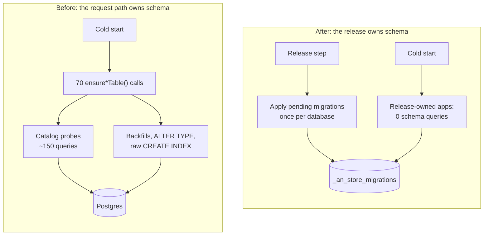

---

## Problem

### The pattern

```ts
let _initPromise: Promise<void> | undefined;
export async function ensureTable(): Promise<void> {
  if (!_initPromise) {
    _initPromise = (async () => {
      await ensureTableExists(TABLE, CREATE_SQL);
      await ensureColumnExists(TABLE, "x", "ALTER TABLE ... ADD COLUMN ...");
      await ensureIndexExists("idx", "CREATE INDEX ...");
      await client.execute("UPDATE ... backfill ...");
    })();
  }
  return _initPromise;
}
```

Core has **70 stores** written this way and about **1,100 `await ensure*()` call
sites**. This is what the first call to each store did on a cold start:

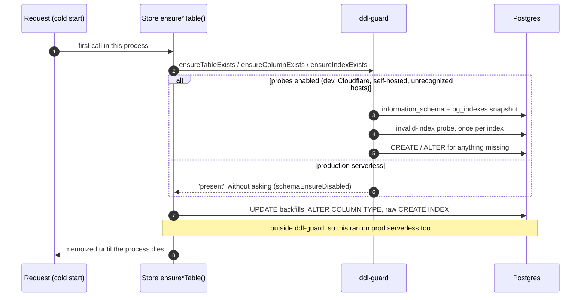

### What it cost

I measured one cold start that touches every framework store, against a
database that was already fully migrated:

| Runtime                                                                                | Statements per cold start | Of which                                                                                                                                              |
| -------------------------------------------------------------------------------------- | ------------------------- | ----------------------------------------------------------------------------------------------------------------------------------------------------- |
| Probes enabled (long-lived Node, `netlify dev`, Cloudflare, any host not env-detected) | ~220                      | 2 full `information_schema.columns` + `pg_indexes` reads, 148 per-index invalid-index probes, 23 backfill writes, ~35 DDL / `ALTER`, plus the rest    |
| Production serverless (Netlify, Vercel, Lambda)                                        | ~50                       | Backfills and DDL that bypass the probe short-circuit (below)                                                                                         |
| **This proposal, hosted**                                                              | **1**                     | `SELECT store_id, name FROM _an_store_migrations`                                                                                                     |

Warm requests were already free in every case, because of the per-process memo.
The cost is per cold start, and cold starts are the thing serverless has most
of.

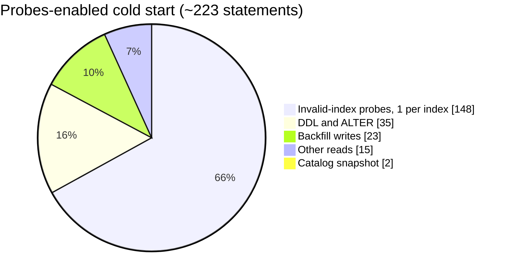

Some of the leftover production statements were not only slow but hazardous:

- `provider-api/corpus-jobs-store.ts` ran 10, and `staged-datasets-store.ts` 5,
  unconditional `ALTER TABLE ... ALTER COLUMN ... TYPE BIGINT` statements per
  cold start, with errors swallowed. `ALTER COLUMN TYPE` takes an `ACCESS
  EXCLUSIVE` lock even when the column is already `BIGINT`, so one cold start
  could queue every reader of the table behind it.
- `extensions/store.ts` ran `INSERT INTO tools ... SELECT FROM extensions`, a
  full-table `UPDATE tool_data SET scope_key = ...`, and a `DROP INDEX IF
  EXISTS` per cold start.
- `a2a-continuations-store.ts` and `oauth-tokens/store.ts` ran two `UPDATE`
  backfills each per cold start.
- `extensions/slots/store.ts` and `review/suggestions/store.ts` issued raw
  `CREATE TABLE` / `CREATE INDEX IF NOT EXISTS`. `CREATE INDEX IF NOT EXISTS`
  takes a `SHARE` lock on the table before it checks whether the index exists.

### Why the existing mitigations are bandaids

Three mechanisms were added over time. Each compensates for the one below it,
and none of them makes schema have a single owner.

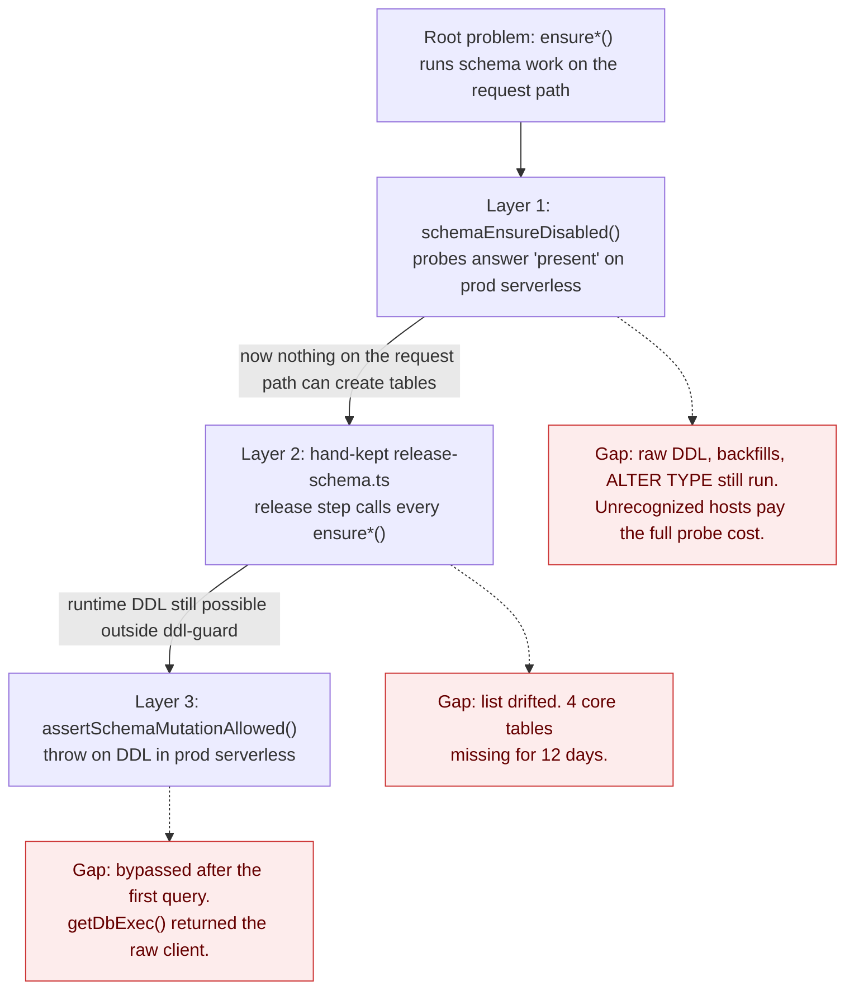

1. **`schemaEnsureDisabled()`** (`db/ddl-guard.ts`). On production serverless,
   every table/column/index probe answers "present" without asking the
   database. The ensure calls stay on the hot path; they just stop doing
   anything, based on environment sniffing. Anything outside the ddl-guard
   helpers (raw DDL, backfills, `ALTER TYPE`) still runs. Hosts the sniff does
   not recognize, such as Cloudflare, pay the full probe cost.
2. **`server/release-schema.ts`.** Because runtime could no longer create
   tables, the release step had to call every store's `ensure*()`. That list was
   hand-maintained, needed its own guard to stay complete, and still went
   stale: `settings`, `application_state`, `app_secrets` and `resources` were
   missing from it for twelve days while deploys reported success. It also
   reused runtime code as migration code, which is how backfills and `ALTER
   TYPE` ended up running on every cold start.
3. **`assertSchemaMutationAllowed()`** (`db/client.ts`). Throws on DDL in a
   production serverless request, but only for the first query in a process:
   `getDbExec()` returned the raw, unguarded client once initialized. The same
   `CREATE TABLE` threw or silently ran depending on query order.

#### How it got here

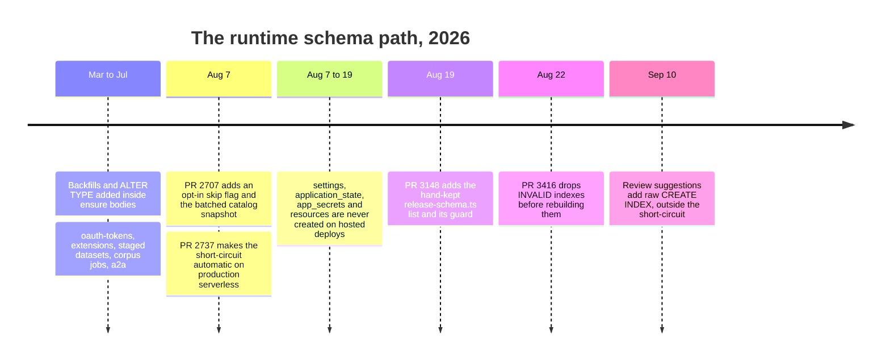

#### What `schemaEnsureDisabled()` did protect, and what it did not

It is fair to say the short-circuit removed real cost. On Netlify, Vercel and
Lambda every probe made through the ddl-guard helpers answered without a
query, which is most of the difference between ~220 and ~50 statements in the
table above. It did not protect:

- **Anything outside ddl-guard.** Most leftover statements predate the
  short-circuit (March through July) and it never covered them. The review
  suggestions indexes were added a month after it, which shows the model's
  weakness: every new raw statement goes straight back onto the hot path.
- **Hosts the environment sniff does not recognize.** Cloudflare, `netlify
  dev`, and self-hosted or long-lived Node paid the full probe cost.
- **Correctness.** Answering "present" without looking is what left four core
  tables uncreated on hosted deploys between PR 2737 and PR 3148.

| Hosted cold start                                 | Before (short-circuit on)     | After (ledger)        |
| ------------------------------------------------- | ----------------------------- | --------------------- |
| Touches only stores built entirely on ddl-guard   | 0 queries                     | 0 queries             |
| Touches every framework store                     | ~50 statements, some locking  | 0 queries             |
| Release whose ledger disagrees with the code      | undetected until a query fails | release step fails, functions never published |

An earlier draft read the ledger once per cold start and threw
`SchemaNotMigratedError` from requests. Review (Steve, PR #6240) pointed out
that this turns a missed release into a sitewide error, which is riskier when
not every deploy lane migrates the same way, and that the goal is zero
database work on cold starts. The check moved to the release step.

---

## Goals

- Zero DDL, zero backfills, and zero per-object probes on any hosted request
  path.
- One schema-related query per process on hosted runtimes, total, not per
  store.
- A missing migration is a loud, typed failure, not a `relation does not
  exist` from an unrelated request or a silently empty table.
- One definition of each store's schema. No hand-kept list that can drift.
- No change to how local development feels: a fresh `pglite:` database still
  provisions itself on first use.
- Every step additive and reversible. No schema is dropped or renamed.

## Non-goals

- Replacing the existing versioned migration lists (`runMigrations(...)` for
  agent runs, chat threads, oauth tokens, org, and others). They keep running in
  the release step after the store pass. Consolidation is an open question.
- Changing how templates own their tables in `server/plugins/db.ts`.
- Removing the ~1,100 `await ensure*()` call sites in this change. They now cost a
  resolved promise; removing them is a mechanical follow-up.
- Reducing the cost of a fresh install. That is Phase 2.

---

## Design

### Components

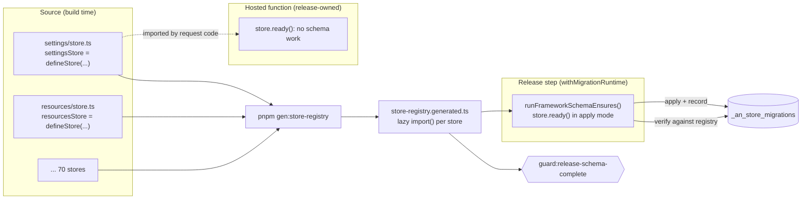

### `defineStore()`

`packages/core/src/db/store-registry.ts`:

```ts
export const installationsStore = defineStore({
  id: "integration_installations",
  migrations: [
    { name: "baseline", run: async () => { /* create table + indexes */ } },
    { name: "widen-bigint", run: (exec) => widenIntColumnsToBigInt(...) },
    { name: "backfill-owner", sql: "UPDATE ... WHERE owner IS NULL" },
  ],
});

export function ensureTable(): Promise<void> {
  return installationsStore.ready();
}
```

Rules, enforced by `defineStore` at module load:

- `id` is unique across the registry and stable forever.
- Migration names are unique within a store, stable forever, and append-only.
  Changing what a store needs means adding a migration, not editing one.
- Each migration has `sql`, `run`, or both, and must be idempotent. The ledger
  makes steady state run-once; idempotency makes a first run that races
  another process safe.

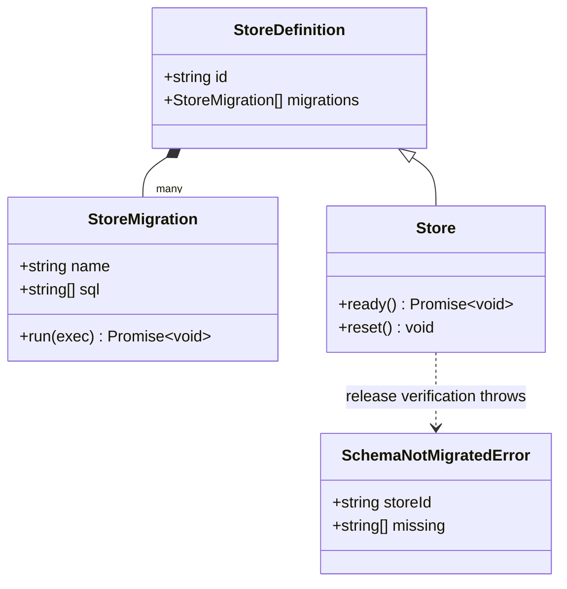

`sql` also accepts a single string. `sql` and `run` are each optional, but a
migration needs at least one.

### The ledger

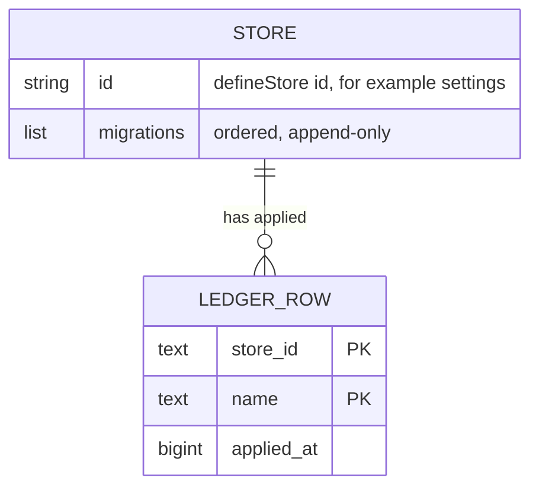

`LEDGER_ROW` is the `_an_store_migrations` table. `STORE` exists only in code.
A migration moves through these states:

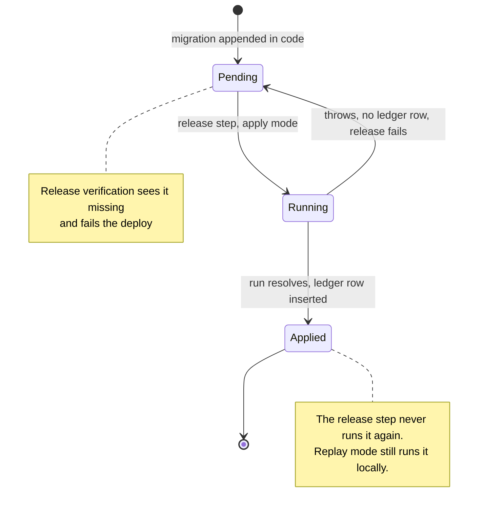

### Readiness modes

`store.ready()` is memoized per process and per mode. The mode is decided by
who owns the schema, not by which platform we think we are on:

| Mode              | When                                                                                                       | What `ready()` does                                                                                                                                                   |
| ----------------- | ---------------------------------------------------------------------------------------------------------- | --------------------------------------------------------------------------------------------------------------------------------------------------------------------- |
| **apply**         | Inside `withMigrationRuntime()` outside a hosted function: the release step                                | Creates the ledger once, skips the store if the shared ledger snapshot lists every migration, otherwise applies pending migrations and records each. The only writer. |
| **trust**         | A hosted function of an app that migrates at release (`appMigratesAtRelease()`)                            | Nothing. No DDL, no probe, no ledger read; the release step applied and verified the schema before this function was published.                                         |
| **hosted-replay** | A hosted function of an app that does **not** migrate at release (the default)                            | `replay`, inside `withMigrationExecutionRuntime()`, exactly what `ddl-guard` already does for these apps on main. Never writes the ledger.                              |
| **replay**        | Everything else: local dev (including against a remote database), tests, self-hosted Node                  | Runs every migration in order, as the old ensure body did. Idempotent. Never writes the ledger.                                                                        |
| **skip**          | `AGENT_NATIVE_SKIP_ENSURE_TABLES` is set and the runtime is not the release step                           | Nothing, the operator opt-out `ddl-guard` already honors.                                                                                                              |

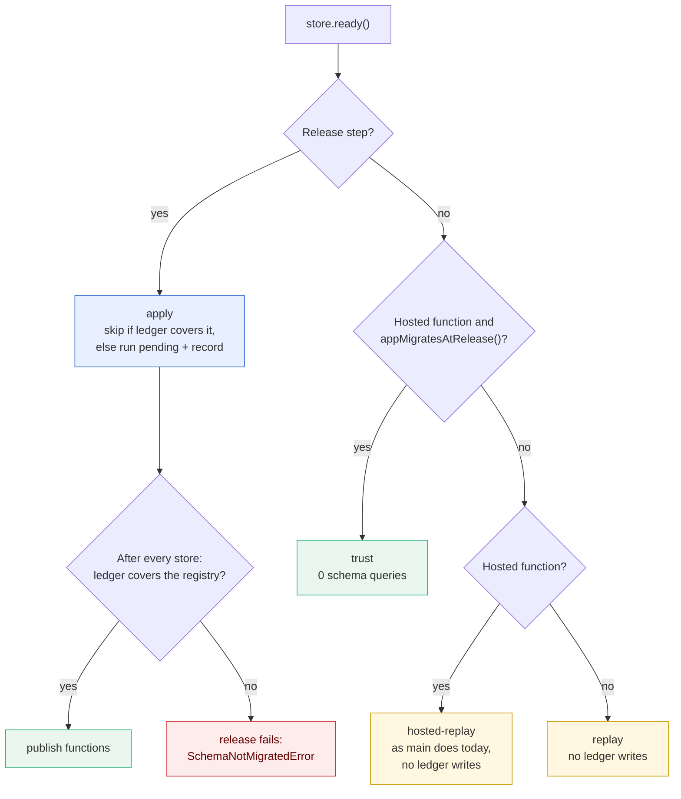

**Only the release step writes the ledger.** A request can never record a
migration, for two reasons found in review. PR previews deploy without release
migrations and point at the production database, so a request-written row
would record a PR's unmerged migration by name in production's ledger. And a
store is often first touched inside a caller's transaction (Better Auth
sign-up), so anything a request writes can roll back while the process
believes it happened. With the ledger written only at release, neither can
happen. Hosted apps that do not migrate at release therefore pay what they pay
on main today, not the one-query cost.

**Who owns the schema.** The mode follows `appMigratesAtRelease()`
(`db/migration-policy.ts`) and the same hosted-runtime predicates as
`ddl-guard` and `assertSchemaMutationAllowed`, so the runner and the guards
cannot disagree. A local process with `releaseMigrations` set and a remote
`DATABASE_URL` replays, as `ddl-guard` provisions there on main.

**Release verification and lock.** After applying, the release step reads
the ledger once and compares it with every registered store
(`findUnappliedStoreMigrations`); a disagreement throws and fails the deploy.
The whole release (store pass, Better Auth and every versioned list) runs
under a lease row in `_an_store_migration_lock`, so two release steps against
one database (a beta and production sharing a schema, a retried deploy) take
turns. A lease row rather than `pg_advisory_lock`, because session locks do
not survive transaction poolers such as Neon's. The holder renews the lease
every five minutes; a crashed holder's lease expires after 15. A failed unlock
never masks the migration's own error.

**Release-only stores.** `defineStore({ releaseOnly: true })` never provisions
from a request, even in hosted apps that do not migrate at release. Identity
SSO and workspace user groups use it, matching main, where both returned early
on every hosted runtime.

**Per-database state.** The ledger snapshot and every store's memo are keyed
to the database client generation (`dbClientGeneration()`), which
`closeDbExec()` and dev reloads bump, as is the `ddl-guard` catalog snapshot.
Without that, a process that reconnected to another database (tests, a script
migrating several databases) served stale readiness and could write a ledger
row for a table the new database never got.

**Pool scope.** The memoized `ready()` promise is wrapped in
`retainRequestDbPoolScope()` once, in the runner. Main added that wrapper by
hand to every store's `_initPromise` (#7320) so a Cloudflare request pool
outlives a shared initialization; the runner now owns it, and no store repeats
it.

**Apply order.** The release step applies stores in registry order, which is
by store id. A migration may therefore only touch its own store's tables.

### The registry is generated, not a side effect

`scripts/gen-store-registry.ts` scans `packages/core/src` for
`export const X = defineStore({ id: "..." })` and writes
`src/db/store-registry.generated.ts`: an explicit list of lazy `import()`s.

- **Why not self-registration on import:** `package.json#sideEffects` is a
  narrow allow-list, so a bundler may drop an import kept only for its
  registration. The symptom would be a table missing in production months
  later.
- **Why lazy imports:** `server/index.ts` re-exports the release entry point.
  A static list would pull every store module into every cold start to serve a
  step that runs once per deploy.
- **Why codegen and not a glob:** core builds with `tsc`, which has no
  `import.meta.glob`.

`guard:release-schema-complete` fails when:

- `store-registry.generated.ts` or `store-migrations.lock.json` is stale;
- two stores share an id, or a `defineStore()` call is written in a form the
  generator cannot read (it would otherwise be skipped silently);
- a module creates tables without being reachable from the registry or
  `release-migrations.ts`, or calls `ensureColumnExists` / `ensureIndexExists`
  outside a registered store (two reviewed exceptions carry
  `guard:allow-unreleased-schema`: `sharing/indexes.ts` and
  `triggers/event-queue.ts`, which Phase 2 step 2 folds in);
- **an existing store migration was edited, renamed, reordered or deleted**,
  compared against the base branch's `store-migrations.lock.json`. The lock
  records every migration's name in order and a checksum of each `sql`
  migration (`run` bodies are not hashed; minifiers rewrite them).

`guard:additive-migrations` also scans every store module for destructive DDL.

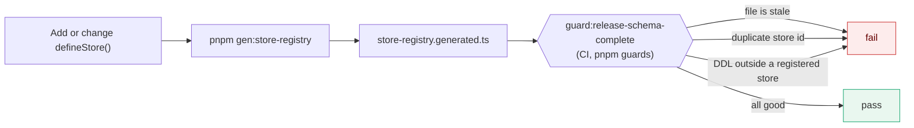

### Release flow

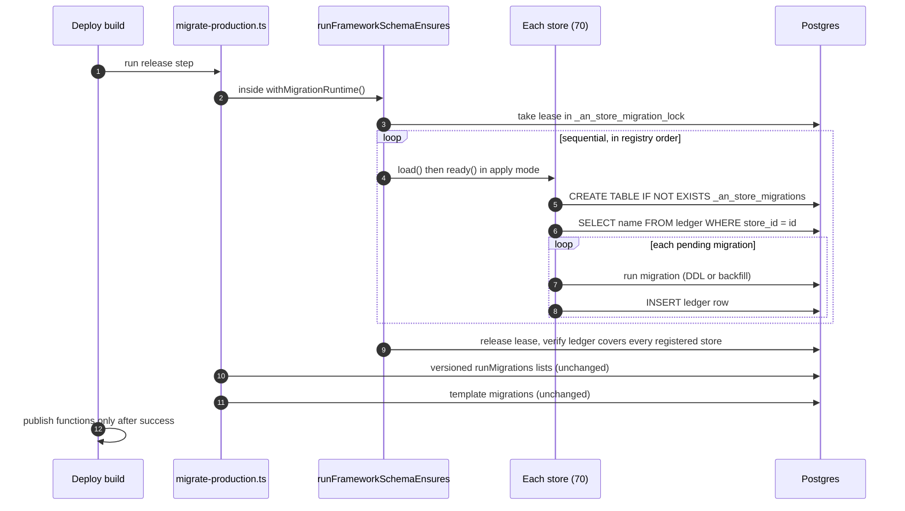

`runFrameworkSchemaEnsures()` now refuses to run outside `withMigrationRuntime`.
Before, it ran and silently created nothing.

### Request flow (hosted, release-owned)

A release-owned hosted function's `store.ready()` resolves without touching
the database. If a table is somehow missing anyway (a deploy lane that skipped
the release step), the query fails with the existing missing-relation
annotation from `getDbExec()`, on the one request that needed that table,
rather than every store failing every request.

### Client guard fix

`getDbExec()` now always returns the same guarded proxy instead of handing out
the raw client after the first query. Every statement goes through
`assertSchemaMutationAllowed`, argument sanitizing, and missing-table
annotation, whatever the query order.

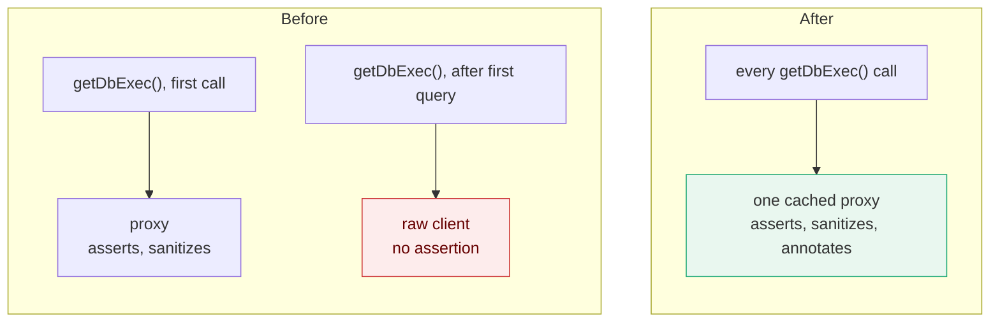

---

## What changed in the reference implementation

| Area                                  | Change                                                                                                                                                                                                                   |
| ------------------------------------- | ------------------------------------------------------------------------------------------------------------------------------------------------------------------------------------------------------------------------ |
| `db/store-registry.ts` (new)          | `defineStore`, readiness modes, ledger, `SchemaNotMigratedError`, `schemaIsReleaseOwned()`                                                                                                                               |
| `db/runtime-facts.ts` (new)           | `retryOnDdlRace` moved out of `client.ts` (re-exported from there) so the runner does not couple to every `vi.mock("../db/client.js")`; runtime predicates come from main's `migration-runtime.ts`                                       |
| `db/store-registry.generated.ts` (new) | 70 stores                                                                                                                                                                                                                |
| `guards/store-registry-codegen.ts` (new), `scripts/gen-store-registry.ts` (new) | Discovery and rendering, shared by the generator and the guard                                                                                                                                                           |
| `guards/release-schema-complete.ts`   | Checks against the generated registry, plus staleness and duplicate ids                                                                                                                                                  |
| `server/release-schema.ts`            | Hand-kept list of 68 entries replaced by the generated registry; asserts migration runtime                                                                                                                              |
| `db/client.ts`                        | `getDbExec()` returns the cached guarded proxy                                                                                                                                                                           |
| 70 store modules                      | `_initPromise` bodies became `defineStore` migrations; `ensure*()` names and signatures kept and delegate to `ready()`. Backfills, `ALTER TYPE`, and legacy index drops split into their own named migrations, in order |
| `corpus-jobs-store`, `staged-datasets-store` | 15 unconditional `ALTER COLUMN TYPE` replaced by `widenIntColumnsToBigInt`, which only alters columns that are still `integer`                                                                                     |
| `identity-sso-store`, `workspace-connections/groups` | Env-sniffing early returns removed; the runner owns that decision                                                                                                                                           |
| Dead code                             | Unreachable legacy DDL after `return;` removed from several stores                                                                                                                                                       |
| `db/store-migrations.lock.json` (new), `guards/store-migrations-lock.ts` (new) | Every store's migration names in order plus `sql` checksums; `guard:release-schema-complete` fails on an edit, rename, reorder or delete against the base branch |
| Ledger columns                        | `checksum`, `kind` (`schema` / `data`) and `source` (`step`, later `snapshot`) are written from the first release, because Phase 2 cannot backfill them; `core_version` is created now and left null until the release step knows its package version |
| `guard:additive-migrations`           | Also scans store modules for destructive DDL                                                                                                                                                                             |

---

## Why a new ledger instead of extending `runMigrations`

`runMigrations` already has named, append-only entries and a run-once ledger,
so extending it with a verify mode was the obvious alternative. It was not
chosen for Phase 1 because its unit is a list, not a store: each list owns a
bookkeeping table (eight exist), lists are registered by hand in
`release-migrations.ts`, and nothing maps a module's DDL to the list that owns
it, which is the property the generated registry and its guard provide. The
cost is a ninth ledger until Phase 2 step 2 folds the lists in. If the working
group prefers one ledger first, the migration path is the same in reverse:
give `runMigrations` lists a store id and record them in
`_an_store_migrations`.

## Rollout

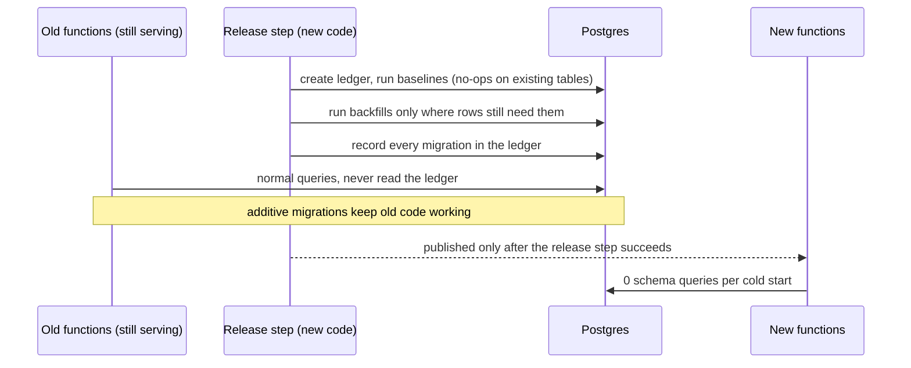

1. **Requests do not depend on the ledger.** Release-owned functions do no
   schema work, exactly as main's `schemaEnsureDisabled()` short-circuit, so a
   function published before (or without) the new release step behaves as it
   does today. The ledger is only read and written by the release step.
2. **First release with this change.** It creates the ledger and runs every
   store's migrations. On an existing database each baseline is a no-op
   (every statement is `IF NOT EXISTS` or probe-guarded), backfills touch only
   rows that still need them, and the ledger is filled.
3. **Old functions still serving during the deploy** never read the ledger and
   keep working, because every migration is additive.
4. **Beta.** Betas that own their schema run the same release step. Betas that
   borrow production's schema serve from it as today; nothing in a request
   reads the ledger, so running ahead of production is not an error.
5. **Hosted apps without release migrations, local and self-hosted.** Replay
   keeps today's behavior and writes no ledger. Nothing to do.
6. **A release step whose ledger disagrees with the code it ships** fails with
   `SchemaNotMigratedError` naming every store and missing migration, before
   any function is published.
7. **Rolling back to an older core** after a release with this change is safe:
   older code ignores `_an_store_migrations`, and every migration was additive.

---

## Upgrade paths: framework users on old databases

This is a framework, so most databases were not created by the current version.
An app is scaffolded once and then upgrades `@agent-native/core` on its own
schedule, sometimes skipping many releases (see the `upgrade-agent-native`
skill). The code already carries the scars: `widen-columns.ts` exists because
long-lived databases kept `INTEGER` timestamp columns, `extensions/store.ts`
copies rows out of a misnamed table from an earlier version, and several
stores add columns that older databases never had.

The release step has to bring any of these starting points to the same place:

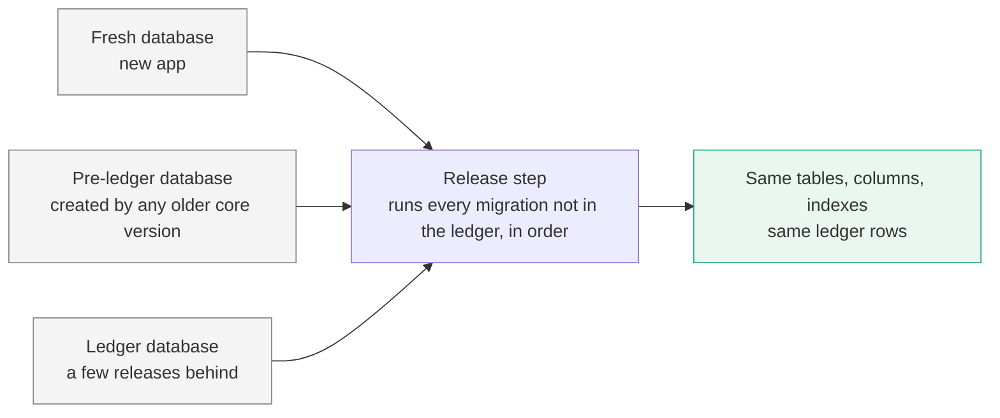

That puts three rules on every store migration:

1. **A baseline converges, it does not just create.** A pre-ledger database
   has no ledger rows, so every store's `baseline` runs against whatever shape
   the table already has. That is why baselines are the old ensure bodies:
   `CREATE TABLE IF NOT EXISTS`, then `ADD COLUMN IF NOT EXISTS` for every
   column ever added, then widening. Squashing a baseline into one clean
   `CREATE TABLE` with today's columns would silently skip every column an old
   database is missing.
2. **Append-only.** A database several releases behind runs exactly the
   migrations it has not recorded, in order. Editing an applied migration never
   reaches it.
3. **Idempotent and additive.** Two release steps can race on a first run, and
   old functions keep serving while the release runs.

### Measured: an Aug 19 database upgraded to this change

I built a database with the release step from PR 3148 (Aug 19, the first
commit with release-time schema creation), ran this change's release step on
it, then compared it with a freshly created database:

| Check                                           | Result                                          |
| ----------------------------------------------- | ----------------------------------------------- |
| Tables, old → upgraded → fresh                  | 139 → 181 → 181                                 |
| Added by the upgrade                            | 42 tables, 389 columns, 124 indexes             |
| Ledger rows, upgraded vs fresh                  | 96 vs 96                                        |
| Second release on the upgraded database         | 0 migrations applied, ledger unchanged          |
| Indexes missing from the upgraded database      | none                                            |

The comparison also found drift that exists independently of this change,
because the old ensure bodies had the same gaps:

- **`tool_shares.notified_at` and `data_program_shares.notified_at`** existed on
  fresh databases but were never added to older ones. This shipped as a
  production failure (every share call on an older database failed) and was
  fixed on main by #7505 with `ensureColumnExists` in each baseline.
- **`context_directives.created_at`, `updated_at`, `active`** are `INTEGER` on
  fresh databases (`CONTEXT_XRAY_MIGRATIONS`) but `BIGINT` on the older one.
  `created_at` stores `Date.now()`, which overflows a 32-bit integer, so
  fresh databases are the broken side here.
- **Migration bookkeeping `version` columns** differ between `INTEGER` and
  `BIGINT`. Harmless.

`server/release-schema.upgrade.spec.ts` now checks this permanently: it loads a
schema dumped from a pre-registry `origin/main` release, runs the current
release step on it, and fails when the catalog differs from a fresh database.
It passes with no drift, and fails on a column added only to a `CREATE TABLE`.

---

## Next: Phase 2, first-time install

### Where Phase 1 leaves a fresh install

The goal is that creating a new app does not run hundreds of schema
statements. Measured 2026-10-13: the full release step
(`runFrameworkSchemaEnsures`, then `runFrameworkReleaseMigrations`) inside
`withMigrationRuntime`, against an empty PGlite database. Each number counts
calls to the database.

|                                                    | Main, fresh                                  | Phase 1, fresh                               | Main, second release | Phase 1, second release |
| -------------------------------------------------- | -------------------------------------------- | -------------------------------------------- | -------------------- | ----------------------- |
| Store ensures / store migrations (68 to 70 stores) | 1,682 (746 catalog probes)                   | 1,948 (769 catalog probes, 123 ledger rows)  | 220                  | 3                       |
| Versioned lists, Better Auth, automation (112 entries) | 697                                      | 697                                          | 59                   | 59                      |
| **Total**                                          | **2,379 (~600 DDL), 186 tables, 456 indexes** | **~2,645**                                   | **279**              | **62**                  |

Template lists come on top of that: analytics has 160 entries, content 126,
mail 38, dispatch 9, chat 0. The default `agent-native create` workspace is
dispatch plus chat.

Phase 1 makes a fresh install slightly **more** expensive. Its baselines are
the old ensure bodies and still probe through `ddl-guard` so they converge old
tables, and every migration now writes a ledger row. Its payoff is everything
after the first install: a second release drops from 279 calls to 62, and a
release-owned hosted cold start does no schema queries at all. Two costs remain outside
the store runner until Phase 2: plugin boot still reads the versioned lists'
ledgers (org, context-xray, observational-memory, Better Auth) unless the app
migrates at release, and `resources` runs its learn-shared content migration
once per process.

Local development is where a new user meets this first: `agent-native create`,
then `pnpm dev` on a fresh `pglite:` database. There, Phase 1 keeps `replay`, so
every store migration runs on first use in **every** process, not once per
database.

### Approach: a squashed schema snapshot

This is what Rails (`schema.rb` / `db:schema:load`), Django
(`squashmigrations`) and Prisma (baselining) do. A fresh database loads one
snapshot of the current schema and is marked as having applied every
migration the snapshot contains. Only migrations added after the snapshot run
step by step. Existing databases never see the snapshot and keep upgrading
step by step, which is why Phase 1's baselines must still converge old tables.

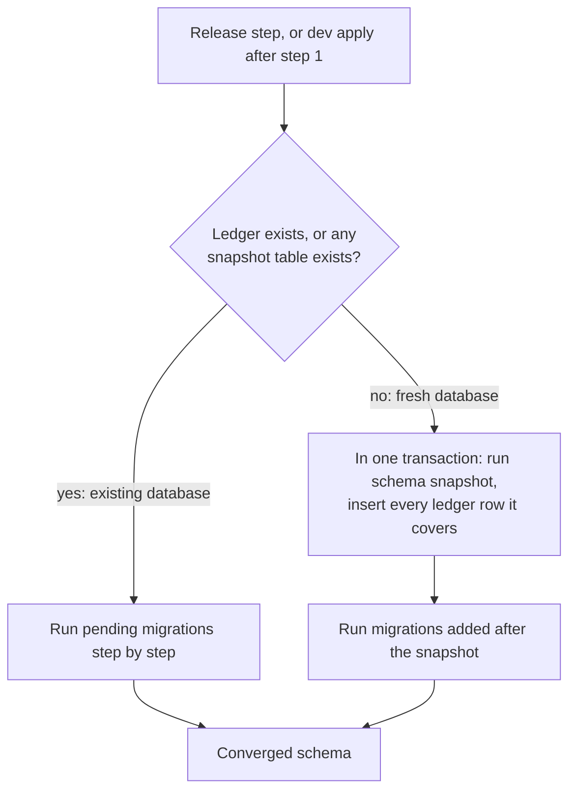

The fresh check has to look at tables, not only the ledger. A database
created before the ledger existed has framework tables and no ledger rows, and
must take the step-by-step path so its baselines can add missing columns.
Several apps can share one database (Design and Slides do), so "fresh" means no
framework table and no ledger row from any app, not just this one.

A snapshot is schema only. Migrations marked `kind: "data"` (backfills and
seeds such as `seed-default-resources` and `seed-sync-version`) are recorded
in the ledger with their kind already, and a snapshot install still runs
them; marking them applied would leave fresh installs without default rows.

### Steps, in order

1. **Ledger in local dev (Q1).** `replay` becomes `apply` for local databases,
   so each migration runs once per database instead of once per process. A
   warm dev boot becomes the shared ledger read. Unit tests that mock
   `getDbExec` need a ledger stub. *Exit:* a warm `pnpm dev` boot issues no
   per-migration statements.
2. **One ledger (Q6).** Move the 112 versioned entries (`ORG_MIGRATIONS`,
   `AGENT_RUN_MIGRATIONS` and the rest) into store migrations, so one runner and
   one ledger cover all framework schema. Without this, a snapshot has to fill
   eight different bookkeeping tables in sync. Existing databases need their
   rows copied from those tables into `_an_store_migrations` first, or the
   moved entries re-run. *Exit:* `release-migrations.ts` calls one runner.
3. **Upgrade convergence test (Q9). Done in Phase 1.**
   `release-schema.upgrade.spec.ts` replays a dumped pre-registry schema and
   upgrades it; `db/schema-catalog.ts` is the dump and fingerprint code step 4
   reuses. Step 4 adds a second comparison: snapshot-fresh against
   step-by-step-fresh.
4. **Framework snapshot.** `pnpm gen:schema-snapshot` runs the release step on
   an empty PGlite database and writes two checked-in files: the resulting
   schema as SQL, and the ledger rows it implies. The generator backs a
   staleness guard, as `store-registry.generated.ts` does, so adding a
   migration without regenerating fails CI. The runner applies the snapshot as
   in the diagram above. *Exit:* a fresh framework release runs a handful of
   statements instead of ~2,400 calls, and the convergence test also compares
   snapshot-fresh against step-by-step-fresh.
5. **Templates (Q7).** Generate the same snapshot for each template's own
   tables once templates declare them with `defineStore`. Generated apps
   already use managed Drizzle migrations (`db/drizzle-migrations.ts`); this
   step has to choose between moving those onto the store runner and teaching
   the snapshot to cover Drizzle's journal. This matters most
   for analytics (160) and content (126). *Exit:* `agent-native create` with
   any public template, then first `pnpm dev`, applies snapshots only.

Step 2 is the first follow-up PR after Phase 1: until it lands there are two
ledgers, which is a new place for drift. Steps 1 and 2 are each useful on their
own; steps 4 and 5 depend on both. In parallel, and not blocked by any step,
sweep the callers that catch everything around a store query so an unmigrated
or missing table can never read as allowed or empty (token revocation, budgets,
access checks fail closed).

### Open points for Phase 2

- **Producing the dump.** PGlite has no `pg_dump` binary on the path. Options
  are a dump built from catalog queries, or a PGlite-compatible dump tool.
  Decide in step 4; whichever is chosen, the generated SQL must be
  deterministic so the staleness guard does not flap.
- **A support floor.** Once a snapshot exists, migrations older than the
  oldest supported release can eventually be deleted. Apps older than the
  floor would upgrade one release line at a time. This needs its own decision
  and is not part of Phase 2.
- **Feature-scoped stores** ([Future work 2](#2-every-app-gets-every-framework-table))
  would shrink the snapshot further, but Phase 2 does not need them.

---

## Risks

| Risk                                                                                | Mitigation                                                                                                                                                                                                                                                                          |
| ----------------------------------------------------------------------------------- | ----------------------------------------------------------------------------------------------------------------------------------------------------------------------------------------------------------------------------------------------------------------------------------- |
| Someone edits an already-applied migration instead of appending one                 | Names are validated but contents are not yet checksummed. Existing databases will not see the edit. Open question below proposes a checksum column.                                                                                                                                 |
| A hosted app that never runs a release step                                         | If it never declared release migrations it replays from requests, as main does. If it declared them and skipped the step, it behaves as main does today with probes skipped: the first query on a missing table fails with the missing-relation annotation.                     |
| A store first touched inside a caller's transaction that rolls back                 | No ledger write can happen outside the release step. The per-process memo can still believe a rolled-back replay succeeded, exactly as main's `_initPromise` memo does; not made worse here, and a follow-up.                                                                        |
| PR previews share the production database                                           | Previews never write the ledger (they do not migrate at release), so an unmerged migration cannot be recorded in production by name.                                                                                                                                                 |
| Ledger read fails (database unreachable)                                            | Throws the underlying error and drops the snapshot, so the next request retries. Never coerced into "migrated".                                                                                                                                                                     |
| An unmigrated store reads as allowed or empty                                       | A few callers catch everything around a store query (desktop SSO's one-time JTI check, budgets, token revocation). Requests no longer raise the typed error, but a missing relation can still be swallowed. Follow-up: sweep those catch-alls so security reads fail closed. |
| `sync_version` (`poll.ts`) used to be created only when hosted realtime transport was on | Now created and seeded unconditionally by the `sync_events` store, because the release step's environment may not match the functions'. It is one small additive table, and the allocator already reseeds a missing row. |

---

## Later phases

After Phase 2: remove the `ensure*()` call sites in favor of a store handle
(Q2), make baselines declarative and delete `schemaEnsureDisabled()` (Q3), and
checksum applied migrations (Q4). None of these changes what a user sees on a
first install, so none of them blocks Phase 2.

## Open questions

Each question names the phase that has to answer it.

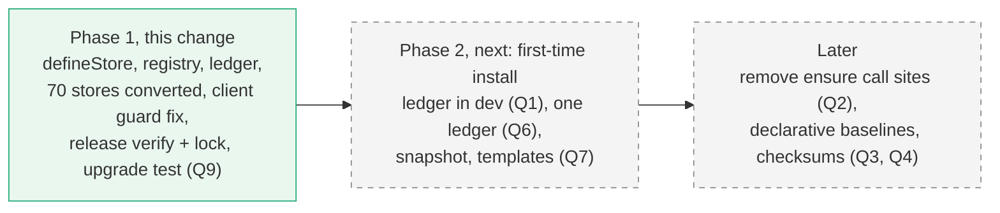

1. **Should replay mode use the ledger too?** *(Phase 2, step 1. Recommended
   yes.)* Today replay re-runs every
   migration once per process, which matches the old behavior, keeps tests that
   mock `getDbExec` unchanged, and avoids a ledger table in unit-test fakes. Using
   the ledger locally would make backfills run once per database everywhere, at
   the cost of one more query per store per dev process and broader test churn.
2. **Remove the ~1,100 call sites.** *(Later.)* Options: keep `await ensure*()` (now a
   resolved promise), or codemod to a store-scoped handle such as
   `await installationsStore.db()` that returns the executor after `ready()`.
   The handle would make "which tables does this code touch" answerable from
   the registry and let a guard forbid raw `getDbExec()` in store modules.
3. **Declarative baselines.** *(Later.)* Baselines still call the ddl-guard helpers so a
   release against a busy production table does not take `SHARE` locks for an
   index that already exists. Converting them to plain SQL would let us delete
   `schemaEnsureDisabled()`, the probe snapshot, and most of `ddl-guard.ts`, but
   needs a release-time `lock_timeout` policy instead.
4. **Migration checksums.** *(Later.)* Record a hash of each `sql` migration in the ledger
   and fail the release when an applied migration's text changed.
5. **Advisory lock at release.** *(Done in Phase 1, as a lease row.)* Two release steps against one database (beta
   and production sharing a schema owner) currently rely on idempotency. A
   `pg_advisory_xact_lock` per store would serialize them.
6. **One ledger.** *(Phase 2, step 2.)* Fold the versioned `runMigrations` lists (`_org_migrations`,
   `agent_run_migrations`, ...) into store migrations so there is one ledger and
   one runner.
7. **Templates.** *(Phase 2, step 5.)* Extend the generator to `templates/*/server/**` so app-owned
   tables use `defineStore` too, and move each template's
   `server/plugins/db.ts` onto the same runner.
8. **Verify eagerly or lazily?** *(Resolved: neither.)* Requests never read the
   ledger; the release step verifies it before publishing.
9. **Upgrade convergence in CI.** *(Done in Phase 1.)* Check in a schema dump produced by an old
   release (for example the oldest core version we still support), run the
   current release step on it in PGlite, and fail when its tables, columns,
   types, or indexes differ from a fresh database. The one-off version of this
   test found the drift listed under [Upgrade paths](#upgrade-paths-framework-users-on-old-databases).
   It also constrains question 3: a declarative baseline must still converge
   an old table, not only create a new one.

---

## Future work (not scheduled)

The registry and ledger make three more long-running problems solvable. None
is scheduled. They are listed so the working group can judge the design against
where it needs to go. The squashed snapshot that used to be listed here is now
[Phase 2](#next-phase-2-first-time-install).

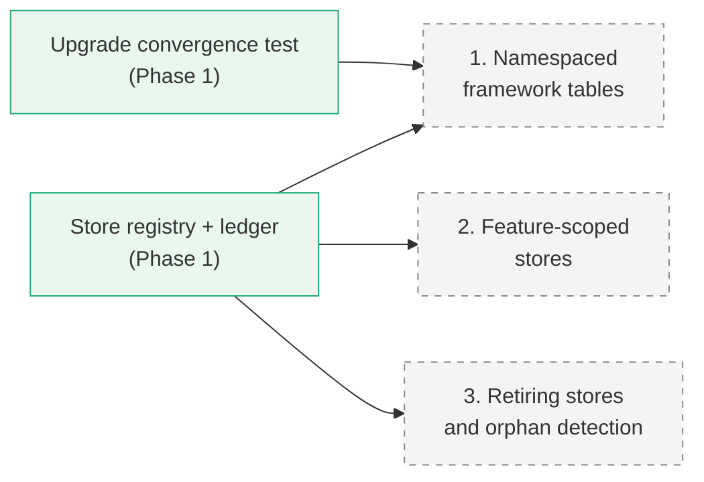

### 1. A naming convention for framework tables

**Problem.** Framework tables share the `public` schema with app tables and use
generic names: `settings`, `resources`, `notifications`, `progress`, `usage`,
`tools`, plus Better Auth's `user`, `session`, `account`. A fresh database has
about 180 tables, and nothing tells a user or a template author which ones the
app owns. An app that defines its own `notifications` table collides with the
framework today, and nothing warns about it until something breaks.

Two ways to fix it:

| | Postgres schema (`agent_native.settings`) | Name prefix (`an_settings`) |
| --- | --- | --- |
| Separation | Real: `\dt public.*` shows only app tables | Visual only: all tables still in `public`, sorted together |
| Collisions | None, different namespace | Unlikely, still one namespace |
| App tooling | Drizzle `schemaFilter: ["public"]` keeps app migrations off framework tables; `pg_dump -n` per owner | Needs a `tablesFilter` glob |
| Uninstall / reset | `DROP SCHEMA agent_native CASCADE` is one reviewed step | Table-by-table |
| Raw SQL (hundreds of statements) | Must qualify names, or rely on `search_path` | Must rename every reference |
| `search_path` | Not safe to rely on: transaction-mode poolers (Neon, PgBouncer) do not keep session settings, so qualify explicitly | Not involved |
| Catalog probes | 21 core modules name the `public` schema (catalog probes such as `table_schema = 'public'`, plus `public.`-qualified queries) and need a schema parameter | Unchanged |
| Drizzle | `pgSchema("agent_native").table(...)` | Rename the table string |
| Moving existing tables | `ALTER TABLE ... SET SCHEMA` is metadata-only but briefly takes `ACCESS EXCLUSIVE` | `ALTER TABLE ... RENAME`, same lock |
| Better Auth tables | Needs verification that its adapter can target a non-`public` schema | Renamable through its `modelName` option |

**Recommendation to debate: a Postgres schema, with explicitly qualified names.**
It is the only option that actually removes framework tables from the app's
view and from app tooling. The cost is mostly mechanical, and the registry
gives it one home: `defineStore` gains a `schema` (default `agent_native` for
framework stores) and hands out qualified table names, so raw SQL builds names
through the store instead of string literals. A guard can then fail on an
unqualified framework table name in new code.

**Moving tables without breaking rolling deploys.** Either approach renames
tables that old functions are still querying during a deploy, and it conflicts
with the "additive only" rule in AGENTS.md. It needs an explicit exception, and
a two-release plan with compatibility views:

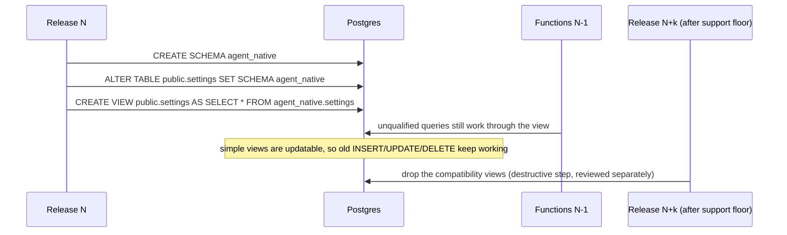

A cheaper first step: new stores go into `agent_native` from day one, existing
stores move later. The drawback is that for a while there are two conventions.

### 2. Every app gets every framework table

**Problem.** An app that never uses extensions, A2A, remote devices, usage
budgets, or review suggestions still gets their tables.

**Proposal.** `defineStore` declares the feature it belongs to, and the release
step migrates only stores for features the app config enables. Turning a
feature on later is a config change and a redeploy, and that release creates
its tables. A disabled feature's store fails with `SchemaNotMigratedError` if
code touches it, rather than with a missing relation. Core stores (auth,
settings, application state, resources, sync) are always on.

### 3. Retiring stores and finding orphans

**Problem.** Additive-only is right for rolling deploys, but there is no way
to retire a table after a refactor. The old `extensions` table lived on after
the rename to `tools`, and every future refactor will leave something behind.

**Proposal.**

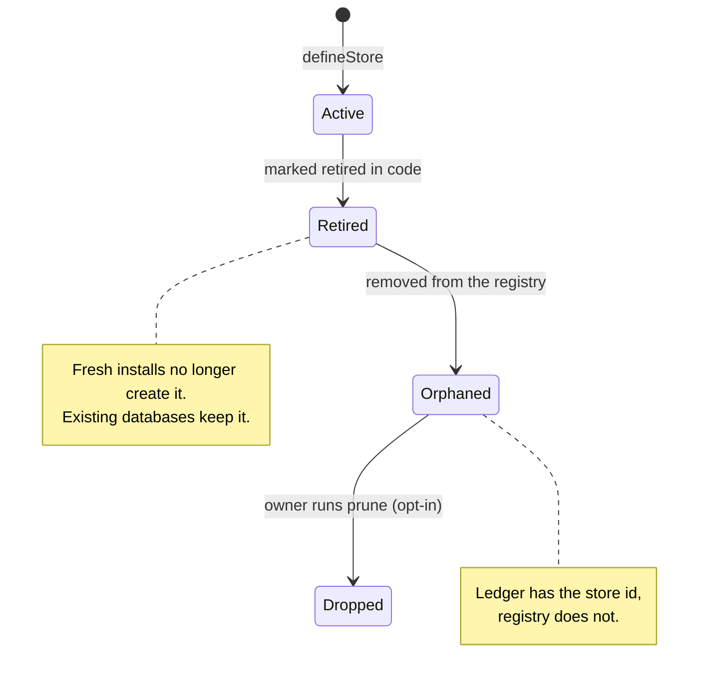

- A retired store stays in the registry with a `retired` marker. Snapshots
  ([Phase 2](#next-phase-2-first-time-install)) stop creating it and nothing new reads it.
- The ledger makes orphans visible: a store id in `_an_store_migrations` with
  no registered store. `agent-native db prune --dry-run` lists them with row
  counts, and only an explicit, reviewed command drops anything. The framework
  never drops tables on its own.
- A rename is a new store, a copy migration, and then retiring the old store.
  This is what the `extensions` → `tools` rename did by hand.

---

## Verification done

- `db/store-registry.spec.ts` against PGlite: apply runs once per database and
  records the ledger with checksum, kind and source; a failed migration is not
  recorded; a release-owned hosted runtime does no schema work; release
  verification names missing migrations; the release lease serializes two
  steps and takes over an expired one; hosted apps without release migrations
  replay without writing the ledger; the skip flag is honored; readiness resets
  when the database clients close; DDL through `getDbExec()` is rejected in a
  hosted runtime even after the client is initialized.
- `server/release-schema.cold-start.spec.ts`: after a real release pass on
  PGlite, a simulated release-owned hosted cold start readies all 70 stores
  without issuing a single statement.
- `server/release-schema.upgrade.spec.ts`: a database dumped from a
  pre-registry `origin/main` release upgrades to exactly the fresh schema;
  verified to fail when a column is added only to a `CREATE TABLE`.
- `guards/store-migrations-lock.spec.ts`: appended migrations pass; edited,
  renamed, reordered and removed ones fail.
- Full `packages/core` suite and the schema guards; see the PR for current
  numbers.

Two behaviors changed to keep the ledger honest: at release, `widenIntColumnsToBigInt`
and the optional `resources_visibility_expires_idx` build now throw instead of
swallowing errors, so a failed step is retried on the next release rather than
recorded as applied. Outside the release step they still degrade quietly, as
before.
