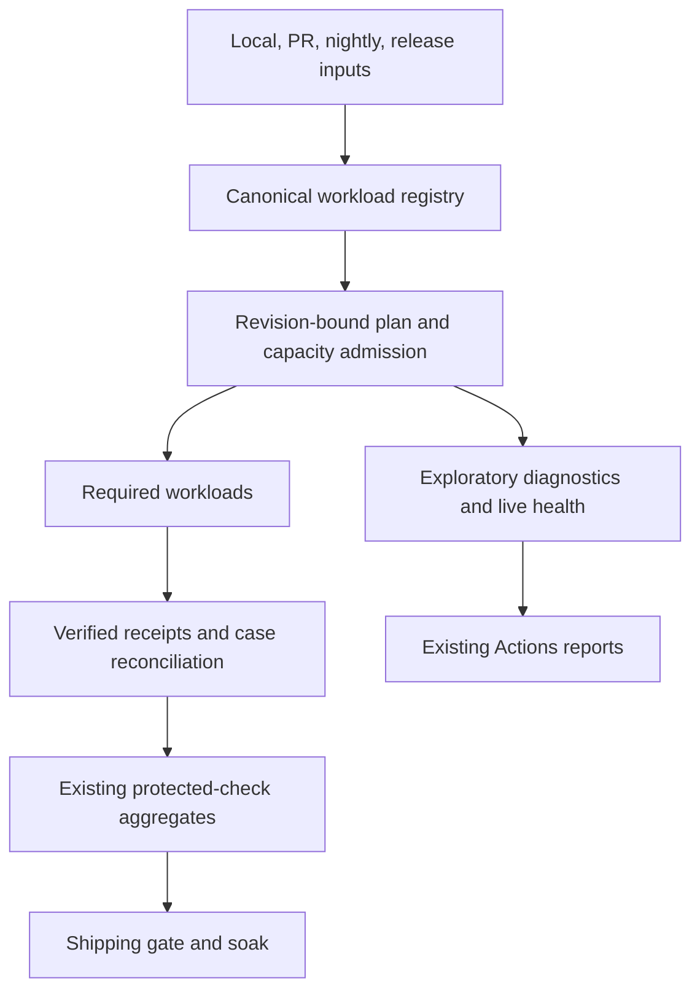

This proposal gives local, pull request, nightly, and release runs one plan for selecting work and deciding what blocks. Required checks prove completion for the intended revision; diagnostics and live health remain visible outside merge eligibility. V0 repairs reproduced failures, keeps existing runners and the global ten-minute shipping soak, and leaves production promotion manual.

The Design defines policy and boundaries. The Implementation Plan maps the contracts to existing CI and product owners.

## Problem

CI selects checks from changed paths and balances fast-test lanes mainly by file count; selection, planning, and required-check aggregation remain separate. A Design diagnostic run scheduled 48 jobs and used 663.9 runner minutes, reporting Motion and line-height failures. Nightly full tests ran 90 minutes 25 seconds and recorded cancellation metadata.[^design-run][^nightly-run] Content convergence passed in 40 minutes 13 seconds.[^content-run] These are observations, not failure-cause or flake-rate claims.

Observed repairs cover a Design action 404, fixed-delay preview readiness, beta badge/auth, Chat stale-run recovery and answer ordering, and Slides-2 pause/resume and hidden retry.[^design-404][^beta-badge][^beta-auth][^chat-stale][^slides-retry] Motion, line-height, and Content correctness remain required. Receipts prevent incoherent evidence; no dropped-work defect is claimed.

## Solution Summary

Reuse the classifier, lane planner, CI aggregates, workspace/guard runners, and Actions artifacts. A canonical registry and plan bind exact cases, owners, gates, runners, revisions, and resource demands. Verified receipts cover planned work; required failures block and diagnostics report separately. Protected contexts are read-only. Cheap path classification starts lint, build, and guards without waiting for dependency-backed discovery; test executors alone wait for one case/lane inventory artifact, enumerated once.



The one-year direction extends this revision-bound policy to new packages, browser projects, site checks, and configuration changes. V0 has three independent tracks: foundation, five repair groups, and selected-site qualification; all must pass their acceptance criteria on current main.

## Goals

- Select every workload through one registry and prove required work with execution-bound receipts.
- Keep existing protected contexts read-only and preserve required Content, Motion, and line-height correctness.
- Balance by compatible workload duration within one per-plan resource budget.
- Qualify the selected non-live site candidate before manual production upload.

## Non-Goals (v1)

- Replacing GitHub Actions, current runners, or test frameworks.
- A new dashboard, CI service, or automatically started production promotion.
- Branch-protection writes, coverage reduction, blanket retry/timeout increases, or larger runners as a default response to red runs.
- Mutating live product data, adding production credentials/defaults/organizations, or running authenticated writes against production.
- Unmeasured cache and code-generation tuning; the historical Core exact-poll-count issue already has a verified fix.

## Registry and gate policy

A workload is one selected suite or shard. The canonical registry maps each family to its owner, selector, runner/project/variant, discovery config, cases, resource request, retry rule, gate class, and exactly one protected aggregate. Selector keys are distinct from protected names. Unregistered selections, unknown contexts, unreadable inventories, or mapping drift fail; unknown changed paths retain the full-run fallback.

Discovery records exact Vitest/Playwright IDs by project and variant, assigning every case to one family. Existing selectors remain; selected required Content, Motion, and line-height cases report to Fast tests. Only declared exploratory diagnostics and live fleet health are advisory.

The registry and plan identify applicable work before execution. An inapplicable workload is recorded as not scheduled with a reason; it produces no fabricated pass receipt. A planned workload must produce one execution receipt. Duplicate receipts, missing cases, duplicated cases, cross-execution artifacts, stale revisions, or incomplete inventories fail. Required failure, timeout, cancellation, skip, or expected-failure blocks. Existing configured retries and protected regression-pin outcomes remain unchanged: a failed attempt followed by a successful retry counts as a pass and remains visible in first-attempt metrics. The Design retry reporter remains an independent required failure when its attestation or pin outcome fails; the marker or artifact alone is not a blanket failure.

## Execution identity and revisions

A plan names its source and the snapshot actually tested. PR execution records candidate head, base, and tested merged snapshot separately. Local execution records the invocation and dirty-tree digest; local evidence cannot qualify a remote PR or release. A CI receipt binds the Actions run ID and attempt, workflow SHA, producer job, logical shard, and workload. The coordinator verifies the artifact’s run, attempt, producer, shard namespace, and workflow metadata against the current expected execution; fields inside a self-claimed receipt cannot establish provenance.

Receipt uniqueness is the tuple of execution, producer, shard, and workload. A second receipt is fatal, even if both copies report the same passing cases. Each required case has at least one contiguous one-based attempt sequence, and its terminal outcome matches the final attempt. An incomplete or canceled attempt set cannot produce a passing receipt. These are internal artifact contracts; readers reject unsupported versions.

## Duration and resource policy

Use only complete successful main-nightly artifacts. Match workload fingerprint, runner, project/variant, cases, and lockfile; retain at most 20 observations from 14 days and require five samples. Estimate nearest-rank p90 active test time, excluding queue, setup, and retries. With no compatible cohort or fewer than five samples, use the existing family-count-weighted planner, capped by selected cases and the family limit, with no empty shards. Corrupt, unreadable, unsupported, or incomplete data fails.

Capacity is a vector of existing workflow-family concurrency caps and per-runner resource limits, admitted per plan. GitHub keeps its normal cross-PR queue; this proposal adds no organization-wide reservation. Fast-test and nightly-fast plans retain eight lanes. Other families retain current workflow caps. The proposed duration policy replaces today's selected-test-count sizing for Design diagnostics: at most 48 shards, bounded by selected cases and active p90 (about one per eight minutes), with at least one shard for a non-empty selection. No empty shard is emitted. Slides-2 keeps 64 logical shards distributed over the eight fast-test lanes, one worker per shard. Oversized family or runner requests fail admission.

| Profile                 | Proposed admission defaults                                                                                                                                                                                        |
| ----------------------- | ------------------------------------------------------------------------------------------------------------------------------------------------------------------------------------------------------------------ |
| CI fast-test executor   | At most 8 fast-test lanes; Vitest workers no greater than available CPUs; package work sequential; browser workers 1; one DB-backed workload per runner. Other families retain existing independent workflow caps. |
| Local unit phase        | Test, typecheck, and guards run sequentially; at most 4 process slots while reserving one CPU when possible; each Vitest process uses one worker.                                                                  |
| Local browser/DB phase  | One active browser or DB-backed slot.                                                                                                                                                                              |
| Workload memory request | Unit: 1024 MiB; browser/DB: 2048 MiB, used as provisional admission values, not claimed runtime footprints. Admit at most half of memory available at run start.                                                   |

Every workload declares CPU slots, browser slots, DB slots, and memory MiB. CI runner profiles supply available CPU and memory; missing family or runner profiles fail planning. Admission sums requests within each family cap and runner. Peak RSS tunes requests; the operating system remains the memory authority, not a hard RSS containment guarantee.

## Public-site qualification

Within one manually started production workflow, build once, stage a non-live draft, qualify its immutable URL with read-only public navigation, then re-upload the same prebuilt bytes without rebuilding. Netlify draft uploads leave the active published deploy unchanged.[^netlify-deploys] Qualification binds candidate deploy ID, site ID, source SHA, non-secret configuration digest, opaque credential-version references, declared test-origin/data overrides, artifact digest, and report ID. The candidate proves public behavior, not production data. The published deploy ID differs from the candidate ID but uses the same artifact and configuration; existing migrations, locks, and post-publish smokes remain. Candidate checks create no product records or live database mutations.

## V0 repair acceptance

The repairs begin with reproductions and assertions that fail before the fix. Run each track independently; all five groups must pass their exact owner cases before V0 is complete.

| Repair group                            | Required proof                                                                                                                                 | Preserved contract                                                          |
| --------------------------------------- | ---------------------------------------------------------------------------------------------------------------------------------------------- | --------------------------------------------------------------------------- |
| Design action and toolkit Context Meter | Existing thread owner gets 2xx and the correct manifest; missing/non-owned thread retains typed 404. Verify query source and action ownership. | Existing ownership behavior and registered manifest remain.                 |
| Design readiness, Motion, line height   | Replace fixed 750 ms wait with deterministic preview readiness; assert DOM and persisted Motion/line-height results.                           | Existing preview cases and persisted-state assertions stay required.        |
| Beta onboarding/auth                    | Cover onboarding HTML, opt-out persistence, badge, and auth surface.                                                                           | Expected badge, opt-out, and authentication behavior remain.                |
| Chat stale run                          | Exercise stale-run recovery and repeated-no-progress classification; prove queued answer order and no repeated external effects.               | Durable receipts, run loop, and execution-lease model remain authoritative. |
| Slides-2 editor                         | Prove pause/resume and hidden retry via generation signal.                                                                                     | Existing editor behavior and one-worker shard execution remain.             |

## Success and rollout

Reuse Actions JSON artifacts, the CI red report, and beta E2E digests. Report first-attempt failures, recovered retries, queue/setup/test/report/soak timing, required-check readiness, and qualification provenance separately. No dashboard is added.

Shadow mode compares exact case sets across docs-only, root tooling, Core, Design, shared-helper, Slides-2, and Content fixtures; omissions, duplicates, and unmapped cases fail. Before enforcement, complete one full nightly plus five paired runs per Core, Design, and Slides-2-heavy cohort on matched SHA, runner, and cache. Proposed acceptance: no increase in first-attempt failures or nearest-rank p90 per cohort, and at least 10% lower p90 for the slowest cohort. These are targets, not results.

Enforce the foundation after selection parity, receipt and ruleset checks, complete nightly proof, and paired-run criteria pass. The three tracks can ship separately; the product repairs and candidate qualification remain V0 acceptance requirements. Roll back duration weighting to file counts and restore the prior gate decision path if criteria regress, while retaining required coverage and receipt validation. For shipping, require ten consecutive green minutes after required checks pass; a required gate failure, head change, or human review restarts the soak, while advisory reports do not.

## Resolved Design Decisions

| Decision                                      | Rationale                                                                                                        | Future                                                   |
| --------------------------------------------- | ---------------------------------------------------------------------------------------------------------------- | -------------------------------------------------------- |
| **One canonical family registry**             | Selection, discovery, ownership, gate, retry, and resources must describe the same workload.                     | New workload families join the registry.                 |
| **Execution-bound receipts**                  | Artifacts are evidence only when the current run, attempt, producer, and shard are verified.                     | Schema versions evolve with adapters and fixtures.       |
| **Current protected contexts stay read-only** | The release reader already fetches live rules; this proposal validates mapping without changing rules.           | Protection changes require separate authorization.       |
| **Measured p90 with explicit fallback**       | Matched active test time improves balance without confusing queue or setup.                                      | Add runner cohorts as evidence grows.                    |
| **Per-plan admission**                        | Prevents local nested fan-out and preserves current runner capacity.                                             | Tune declared requests from peak RSS evidence.           |
| **Draft then same-byte production upload**    | Candidate proof must apply to the published artifact while promotion stays manual.                               | Expand selected-site checks only through release policy. |
| **Three tracks; complete V0 acceptance**      | Foundations, product repairs, and qualification can ship independently without redefining V0 as foundation-only. | Add future apps through the same receipt policy.         |

## Design Recap

- **One registry:** every selected workload has one owner, gate, case inventory, and resource request.
- **Verified evidence:** receipts bind execution metadata and exact revision to complete case outcomes.
- **Required correctness:** selected Design Motion/line-height and Content convergence cases remain blocking.
- **Bounded execution:** duration-based shards fit a per-plan admission budget; the shipping soak remains ten green minutes.
- **Complete V0:** foundations, five repair groups, and selected-site qualification must all meet acceptance.

## Implementation Plan

### Baseline and landed work

The audit used `1368ef4597`; current main includes `5cc9c0fd3e` (#8204). That change already adds selected-test-count Design shards, the eight-lane full nightly, and 64 Slides-2 shards with one worker each. This proposal extends those paths:

| Already present                                                                                                                                                                                                                | Still proposed                                                                                                                                                                                        |
| ------------------------------------------------------------------------------------------------------------------------------------------------------------------------------------------------------------------------------ | ----------------------------------------------------------------------------------------------------------------------------------------------------------------------------------------------------- |
| `designCanvasE2eDiagnosticShardsFor` in `scripts/ci-change-scope.ts` sizes the selected Design specs at 11 tests per shard, capped at 48; `.github/workflows/nightly-full-tests.yml` sets eight lanes and one Slides-2 worker. | Add observed-duration inputs and strict provenance, shared registry/receipt/gate contracts, bounded per-workload resource admission, the reproduced product repairs, and selected-site qualification. |

The 48-job and runner-minute observations above describe the earlier audit run, not the current count-based shard planner.

### Code map

| Component                         | Existing code reused                                                                                                                                                                                                                                                                                                                                                                                                                                                                | Files added or changed                                                                                                                                                                                                                                                                                  |
| --------------------------------- | ----------------------------------------------------------------------------------------------------------------------------------------------------------------------------------------------------------------------------------------------------------------------------------------------------------------------------------------------------------------------------------------------------------------------------------------------------------------------------------- | ------------------------------------------------------------------------------------------------------------------------------------------------------------------------------------------------------------------------------------------------------------------------------------------------------- |
| Classifier and planner            | `classifyChangedPaths`, `CHECK_NAMES`, `writeOutputs`; `main`, `partitionWeighted`, `partitionTargetedWeighted`, `splitLargePackages`, `assertFullCoverage`                                                                                                                                                                                                                                                                                                                         | Keep `change-scope` classification cheap; add dependency-backed `test-plan` using `scripts/ci-test-lanes.ts` and new `scripts/validation-plan.ts` to enumerate selected cases once and publish one inventory artifact to test executors.                                                                |
| Plan execution and local capacity | Workspace profiles in `scripts/workspace-run.ts`; `scripts/run-guards.ts`; root `test:fast` and `guards` in `package.json`; `templates/design/vitest.config.ts`, `vitest.shared.ts`, `packages/core/vitest.config.ts`, `packages/core/src/vitest-config.ts`                                                                                                                                                                                                                         | Add `scripts/validation-run.ts`; root scripts expose `validate` and `validate:gate`; `test:fast` is the full unit-tier alias. Nightly/CI selects the union of the new unit inventory and extracted browser cases, preserving the previous fast-test case set without adding long-running E2E campaigns. |
| Required aggregates and rules     | `fast-tests`, `build-gate`, `guards`; `requiredContextsFromRules` and `evaluateRequiredChecks` in `scripts/release-required-checks.ts`                                                                                                                                                                                                                                                                                                                                              | Update `.github/workflows/ci.yml`; extend `scripts/package-release-workflow.test.ts` for read-only live-context parity and workflow mapping. Never mutate branch rules.                                                                                                                                 |
| Duration feed                     | Existing `designCanvasE2eDiagnosticShardsFor` selected-test-count planner in `scripts/ci-change-scope.ts`; eight-lane full-nightly plan in `.github/workflows/nightly-full-tests.yml`; job timestamps in `scripts/ci-red-report.ts`; 64-shard Slides-2 bound in `scripts/ci-test-lanes.ts`                                                                                                                                                                                          | Extend current shard selection with versioned duration artifact production/consumption and strict validation in `scripts/validation-run.ts`; retain existing nightly lanes and Slides-2 worker bound.                                                                                                   |
| Design and toolkit                | `gotoEditor`, `waitForDesignPreviewReady` in `templates/design/e2e/helpers.ts`; `verifyRequiredPinOutcomes` in `templates/design/e2e/retry-failure-reporter.ts`; `templates/design/playwright.config.ts`; Motion and line-height browser specs; toolkit `packages/toolkit/src/app/context-xray/ContextMeter.tsx`; Core `packages/core/src/client/use-action.ts`, `packages/core/src/agent/context-xray/actions/context-manifest-get.ts`, `packages/core/src/agent/run-ownership.ts` | Update owner specs, retain pin attestation failures as an independent required result, and add registry selectors.                                                                                                                                                                                      |
| Beta onboarding/auth              | `getOnboardingHtml`, `injectBetaOptOutPersistence` and specs                                                                                                                                                                                                                                                                                                                                                                                                                        | Update `packages/core/src/server/onboarding-html.ts`, `beta-opt-out-html.ts`, their specs, and `e2e/beta/specs/auth-surface.spec.ts` / `fleet-public.spec.ts`.                                                                                                                                          |
| Chat recovery                     | `attemptStaleRunRecovery` in `packages/core/src/agent/run-store.ts`; `packages/core/src/chat-threads/store.ts`; `packages/core/src/agent/run-loop-with-resume.ts`                                                                                                                                                                                                                                                                                                                   | Update `packages/core/src/agent/run-store.stale-run-recovery.spec.ts`, `run-loop-with-resume.integration.spec.ts`, and model-check covered execution-lease changes; update the model when protocol behavior changes.                                                                                    |
| Slides-2                          | `templates/slides-2/app/pages/DeckEditor.tsx`; 64-shard bound in `scripts/ci-test-lanes.ts`                                                                                                                                                                                                                                                                                                                                                                                         | Update `templates/slides-2/app/pages/DeckEditor.generation-signal.test.tsx`; retain one worker per logical shard.                                                                                                                                                                                       |
| Content convergence               | Existing `content-convergence-tests` status reporting in `.github/workflows/ci.yml` (outside the `Fast tests` aggregate)                                                                                                                                                                                                                                                                                                                                                            | Move correctness receipts into the shared required aggregate, share the build, and preserve the known-loss advisory report.                                                                                                                                                                             |
| Candidate qualification           | `.github/workflows/deploy-production-sites-prebuilt.yml` (`beta_e2e` default false, retained as a compatible opt-in alias); `.github/workflows/deploy-netlify-prebuilt.yml`; `.github/workflows/promote-netlify-deploy.yml`; `scripts/netlify-prebuilt-target.ts` (`resolveNetlifyImmutableDeployUrl`); `scripts/verify-netlify-prebuilt-client.ts`                                                                                                                                 | Replace all-app preflight with selected-site draft qualification and exact-byte `--no-build --prod` upload verification before the existing post-publish smokes.                                                                                                                                        |
| Shipping and babysitting          | `.agents/skills/ship/SKILL.md`, `.agents/skills/babysit-pr/SKILL.md`; current ten-minute shipping soak                                                                                                                                                                                                                                                                                                                                                                              | Replace duplicated CI prose with the tested gate command; run the agent-friction report before changing guidance and use its existing pattern key.                                                                                                                                                      |

### New contracts

```ts
type RevisionTuple = {
  headSha: string;
  baseSha: string | null;
  testedSha: string;
};

type ExecutionIdentity =
  | {
      kind: "ci";
      runId: number;
      runAttempt: number;
      workflowSha: string;
      producerKey: string;
      logicalShardId: string;
    }
  | { kind: "local"; invocationId: string; dirtyTreeDigest: string };

type ExpectedExecution =
  | { kind: "ci"; runId: number; runAttempt: number; workflowSha: string }
  | { kind: "local"; invocationId: string; dirtyTreeDigest: string };

type WorkloadFamily = {
  familyId: string;
  selector: string;
  discovery: { config: string; project: string; variant: string };
  ownerWorkspace: string;
  gate: "required" | "diagnostic";
  protectedAggregate: string | null;
  retryRule: string;
  concurrency:
    | { mode: "fixed"; max: number }
    | {
        mode: "duration";
        max: number;
        shardBudgetMs: number;
        fallback: { mode: "family-count"; maxCasesPerShard: number };
      };
  request: ResourceRequest;
};

type ResourceRequest = {
  cpuSlots: number;
  browserSlots: number;
  dbSlots: number;
  memoryMiB: number;
};

type ValidationPlanV1 = {
  schemaVersion: 1;
  revision: RevisionTuple;
  registryVersion: string;
  registryDigest: string;
  policyHash: string;
  planHash: string;
  expectedExecution: ExpectedExecution;
  inventory: {
    selected: Array<{
      familyId: string;
      project: string;
      variant: string;
      caseIds: string[];
      reason: string;
    }>;
    inapplicable: Array<{
      familyId: string;
      project: string;
      variant: string;
      reason: string;
    }>;
  };
  workloads: Array<{
    workloadId: string;
    familyId: string;
    project: string;
    variant: string;
    producerKey: string;
    logicalShardId: string;
    caseIds: string[];
    request: ResourceRequest;
  }>;
  budget: {
    familyCaps: Record<string, number>;
    runner: {
      cpuSlots: number;
      browserSlots: number;
      dbSlots: number;
      memoryMiB: number;
    };
  };
};

type WorkloadReceiptV1 = {
  schemaVersion: 1;
  execution: ExecutionIdentity;
  revision: RevisionTuple;
  planHash: string;
  workloadId: string;
  outcomes: Array<{
    caseId: string;
    attempts: Array<{
      attempt: number;
      result: "passed" | "failed" | "cancelled";
    }>;
    terminal: "passed" | "failed" | "cancelled";
  }>;
};
```

Hash lowercase SHA-256 over UTF-8 canonical JSON with object keys sorted. Sort only arrays that represent sets, including case IDs; preserve attempt order. `policyHash` covers the registry version/digest; `planHash` covers the expected execution, complete inventory, workload-to-producer/shard partition, runner requests, and complete declared plan, excluding its own computed hash. For every family/project/variant, workload case partitions must equal the selected inventory exactly: no missing, extra, or duplicate case. Reject unsupported schema versions, malformed hashes, duplicate receipt uniqueness tuples, missing/non-contiguous attempts, terminal/final-attempt disagreement, and any provenance mismatch. Add adapters and fixtures before a schema version change.

PR head, base, and tested snapshot come from the same dispatch/checkout tuple. The gate verifies the live PR head equals the planned head; recorded base and tested snapshot must agree with CI dispatch/checkout evidence. It does not require the recorded base to equal latest main unless existing protected policy requires it. Local dirty-tree evidence cannot qualify a remote PR.

Duration artifacts use schema version 1 and contain producer run/attempt, workflow SHA, completion state, lockfile digest, runner class, workload fingerprint, project/variant, exact case inventory, active test duration, and sample timestamp. Only complete successful main-nightly producers contribute. No compatible cohort or fewer than five samples selects the declared family-count fallback; malformed, unreadable, unsupported, or incomplete producer data fails.

Qualification receipts include execution identity, source SHA, plan hash, candidate deploy ID, site ID, configuration digest, artifact digest, immutable origin, report ID, and result (`passed`, `failed`, or `cancelled`). Production upload receipts bind execution identity and plan hash, record the separately created published deploy ID, and require identical source/configuration/artifact digests and distinct deploy IDs. The plan includes both producer workloads in the same manual workflow run and attempt; a prior run’s qualification is never reused. Configuration hashes include non-secret settings and opaque credential-version refs only.

```ts
type QualificationReceiptV1 = {
  schemaVersion: 1;
  execution: ExecutionIdentity;
  sourceSha: string;
  planHash: string;
  candidateDeployId: string;
  siteId: string;
  configDigest: string;
  artifactDigest: string;
  immutableOrigin: string;
  reportId: string;
  result: "passed" | "failed" | "cancelled";
};

type ProductionUploadReceiptV1 = {
  schemaVersion: 1;
  execution: ExecutionIdentity;
  planHash: string;
  candidateDeployId: string;
  publishedDeployId: string;
  sourceSha: string;
  configDigest: string;
  artifactDigest: string;
};
```

### Change sequence

1. Add and test the canonical registry, exact case discovery, canonical hashing, revision tuples, resource admission, and receipt verification. Split cheap path classification from dependency-backed test planning; non-test jobs start when selectors are ready, and test executors consume one inventory artifact. Classifier selectors remain distinct from protected-context names.
2. Add the local/CI runner and compatibility aliases. `pnpm validate --scope affected|full --profile local|ci --tier unit|browser|all` runs the shared plan; tier defaults to all non-live workloads; `pnpm validate:gate --pr <n> --head <sha>` verifies current Actions execution and attempt, live protected contexts, and receipts before shipping. Keep the existing eight-lane CI fast-test plan. Extend Design diagnostics from selected-test-count sizing to observed-duration sizing, retaining the 48-shard and selected-case limits. The local unit process limit is `max(1, min(4, CPUs - 1))`. Targeted planning preserves full-Core fallback for import-graph and disk-read inputs. Update ship/babysit guidance to use the gate command.
3. Add duration artifacts and the strict fallback/corruption states. Verify full nightly coverage against the prior fast inventory plus extracted browser cases.
4. Land the five product repair groups independently, each with a pre-fix reproduction, exact-case proof, and current-main pass. Content convergence receipts join the foundation aggregate; preserve advisory known-loss output.
5. Add selected-site draft qualification before the production publish step. Reject source, configuration, or artifact digest mismatches before upload; re-upload the exact bytes with `--no-build --prod`[^netlify-cli], compare the new published deploy, and run existing smokes.
6. Complete deterministic parity, one full nightly, and the paired performance cohorts before enforcing the foundation. V0 acceptance additionally requires all repair cases and selected-site qualification.

### Verification

Run `node --experimental-strip-types --test scripts/ci-change-scope.test.ts scripts/ci-change-scope-renames.test.ts scripts/ci-build-workspaces.test.ts scripts/ci-test-lanes.test.ts` and `pnpm exec tsx --test scripts/package-release-workflow.test.ts`. Add focused registry, hashing, provenance, admission, duration-feed, receipt, and workflow-contract tests. Run `pnpm guard:design-e2e-workflow`, `pnpm guards`, and `actionlint` when available. Run the exact owner cases. Run `pnpm verify:execution-lease` when covered execution-lease code changes; update the model when protocol behavior changes. Complete one full nightly and five matched runs per heavy cohort. Verify candidate and published deploy IDs differ and that source/config/artifact digests match before production upload.

## Future Considerations

Later work can add runner classes and more precise workload fingerprints without changing receipt provenance. Cache and code-generation tuning remain out of scope until measured separately.

## References

[^design-run]: [Design E2E run 40189540200](https://github.com/BuilderIO/agent-native/actions/runs/40189540200), GitHub Actions. Shows 48 diagnostic jobs, 663.9 runner minutes, and Motion/line-height failures.

[^content-run]: [Content convergence run 40185824864](https://github.com/BuilderIO/agent-native/actions/runs/40185824864), GitHub Actions. Shows a 40-minute, 13-second run that passed.

[^nightly-run]: [Nightly run 40169721397](https://github.com/BuilderIO/agent-native/actions/runs/40169721397), GitHub Actions. Shows a 90-minute, 25-second run and cancellation metadata.

[^design-404]: [Design action 404 job 121043211626](https://github.com/BuilderIO/agent-native/actions/runs/40151260456/job/121043211626), GitHub Actions. Shows the observed action response symptom.

[^beta-badge]: [Beta badge job 121095376277](https://github.com/BuilderIO/agent-native/actions/runs/40168836738/job/121095376277), GitHub Actions. Shows the observed badge symptom.

[^beta-auth]: [Auth surface job 121032131889](https://github.com/BuilderIO/agent-native/actions/runs/40147574973/job/121032131889), GitHub Actions. Shows the observed auth surface symptom.

[^chat-stale]: [Chat stale-run job 121146187252](https://github.com/BuilderIO/agent-native/actions/runs/40185705662/job/121146187252), GitHub Actions. Shows the observed stale-run symptom.

[^slides-retry]: [Slides-2 polling job 120010140303](https://github.com/BuilderIO/agent-native/actions/runs/39831967092/job/120010140303), GitHub Actions. Shows the observed editor polling symptom.

[^netlify-deploys]: [Draft deploys](https://docs.netlify.com/api-and-cli-guides/api-guides/get-started-with-api/#draft-deploys), Netlify documentation. Shows draft uploads that do not change the active published deploy.

[^netlify-cli]: [Netlify deploy command](https://cli.netlify.com/commands/deploy/), Netlify CLI documentation. Shows draft deployment defaults, production deployment with `--prod`, and skipping build with `--no-build`.
