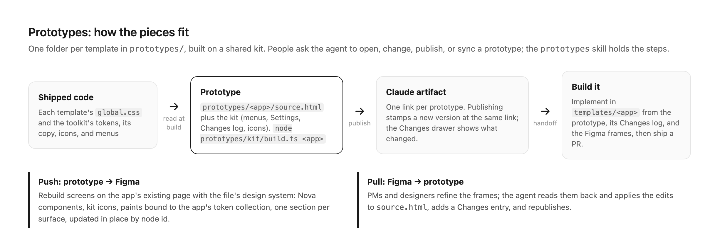

# Prototypes

Clickable prototypes of the Agent-Native templates, one folder each. Each builds into a single self-contained HTML page that's published as a Claude artifact, so a designer or PM can open the link to look, or open the folder in their own Claude to change it.

| Prototype | Template | Artifact |
| --- | --- | --- |
| [Analytics](analytics/) | `templates/analytics` | https://claude.ai/artifact/RtQ5m2aQTSdjdZxAZajX2H |
| [Chat](chat/) | `templates/chat` | https://claude.ai/artifact/GqQxZw4AtoKkQFit9gtGH5 |
| [Clips web](clips-web/) | `templates/clips` | https://claude.ai/artifact/YBWtSNr8esvyFwkDpBHGNw |
| [Clips desktop](clips-desktop/) | `templates/clips/desktop` | https://claude.ai/artifact/PUNqcFC3kAogDLzHDo2XKx |
| [Design](design/) | `templates/design` | https://claude.ai/artifact/MC9u3UmtuV3vbB865gU1kH |
| [Slides](slides/) | `templates/slides` | https://claude.ai/artifact/SKFFSBvDk1xP5GQuBMFhm5 |

## Working on one




Ask the agent to open, change, republish, or Figma-sync a prototype; the `prototypes` skill (`.agents/skills/prototypes/`) has the workflow. `figma` in each `prototype.json` names the app's page in the Agent-Native Figma file and the sections the prototype maps to.

Prototypes aren't shipped code: CI classes `prototypes/` as docs-only, the diff-scoped guards skip it, and oxfmt and oxlint ignore it. Check a prototype by building it and loading the page.

## Layout

```
kit/              shared by every prototype
  base.css        base reset, icon class, the Changes drawer, and the few tokens the code doesn't have yet
  ui.css, ui.ts   the review strip, buttons, segmented control, menus, toasts, ic() and $
  settings.*      the toolkit's Settings shell; settings.json holds the shared pages
  changes.ts      the Changes drawer
  icons.json      the Tabler icons prototypes draw with; add more per prototype with add-icons.ts (a -filled name takes the filled variant)
  build.ts        builds one prototype
<name>/
  source.html     the prototype
  prototype.json  { "template": "<folder under templates/>" }
  changes.json    the change log shown in the Changes drawer
  settings.json   optional: { "app": "<name>", "pages": [...] }, the app's own Settings pages
  dist/           build output (not committed)
```

## Build

```bash
node prototypes/kit/build.ts design
```

This writes `design/dist/index.html`. To publish, ask Claude to publish that file as an artifact; for an existing prototype, give it the artifact link from the table above so the link stays the same.

## Tokens come from the code

The build reads the design tokens from the code every time (including themes that ship dark, with light on `.light`): the toolkit's tokens and Tailwind theme (`packages/toolkit/src/app/styles/tokens/agent-kit.css` and `agent-native.css`) and the template's theme (`templates/<template>/app/global.css`), in light and dark. Use the code's names in prototype CSS: `--color-border`, `--color-muted-foreground`, `--color-accent`, and the template's own, such as `--design-editor-accent-color`. Don't copy values into a prototype. If a prototype needs a token the code doesn't have, define it in `kit/base.css` or the prototype's own `:root` and mark it as not in the code yet.

## When you change a prototype

Add an entry at the top of its `changes.json`, then rebuild and republish:

```json
{ "date": "2026-10-12", "text": "Moved Import into the file menu" }
```

One plain sentence per change, in the past tense, saying what changed for someone using the prototype. Entries run newest first; the build fails on a missing date, empty text, or entries out of order. The Changes drawer marks entries newer than the viewer's last visit.

## Adding a prototype

1. Create `prototypes/<name>/` with `source.html`, `prototype.json`, and a `changes.json` holding its first entry.
2. In `source.html`, put `__KIT_HEAD__` after the `<title>`, `__KIT_SCRIPT__` before the prototype's own `<script>`, and call `kitChangesInit(button)` on the button that opens the Changes drawer.
3. Draw icons with `ic("name")` and menus with `openMenu(anchor, items)`, both from `kit/ui.ts`; use `__LOGO__` for the logo. Any other `__NAME__` placeholder is filled from `<name>/name.json`.
4. Set `--kit-accent` in the prototype's `:root` to the template's accent token, and the `--kit-menu-*` density variables if the app's menus aren't the Design editor's 12px/28px rows. Shared pieces a second prototype needs go in the kit, not copied between prototypes.
5. For Settings, add `settings.json` with the app's own pages (General, What's new, Labs if it has any); a page with the same id as a kit page replaces it. Call `kitSettingsInit({ app, mcpName, mcpUrl })` once, then `openSettings(page)` opens it, and ⌘, works. Shared pages write `{app}` and `{mcpUrl}` where they mean the current app.
6. Build it, publish it, and add it to the table above.
