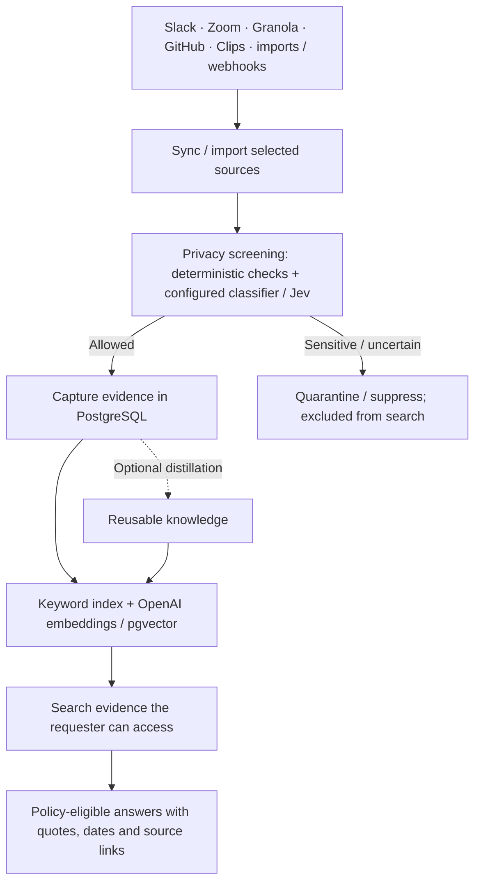
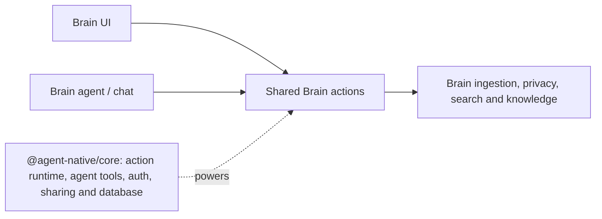

# Brain

An open-source, agent-native alternative to Glean — clean company chat backed by
cited institutional knowledge. Ask a plain-English question and get an answer
from approved company knowledge, with links back to the source.

**Live app: [brain.agent-native.com](https://brain.agent-native.com?utm_source=github&utm_medium=referral&utm_content=brain-readme)**

Brain ingests approved Slack channels, meetings, transcripts, GitHub issues/PRs,
and webhook captures, then searches allowed evidence to answer with quotes and
source links. Distillation into reusable knowledge is a separate, optional path.
Messages from public channels and explicitly invited private channels are
searchable org-wide once they pass sensitivity screening; attendee-scoped
meetings keep their audience, and personal sources stay limited to their owner
and shares.

## Brain at a glance

Brain is the company-knowledge app in this monorepo: **connect → screen → index → ask**.



**Zoom means cloud-recording transcripts, not AI Companion summaries**; admins
approve meeting-series IDs before Brain fetches their transcript content.
Allowed captures can support answers without distillation when retrieval policy
permits; private sources and attendee-scoped evidence retain their access limits.

### Where it fits in Agent-Native



| Layer                                    | Code                                                                           |
| ---------------------------------------- | ------------------------------------------------------------------------------ |
| Brain app and shared operations          | [`app/`](app/), [`actions/`](actions/)                                         |
| Ingestion, privacy and retrieval         | [`server/lib/`](server/lib/), [`server/jobs/`](server/jobs/), [`jobs/`](jobs/) |
| Framework reused by Brain and other apps | [`packages/core`](../../packages/core/)                                        |

## Features

- Company chat grounded in cited evidence and source-answer policy.
- Source connectors for Slack, Zoom, Granola, GitHub, Clips, and generic webhooks,
  including source-owner-published blessed FAQs and docs.
- Deterministic privacy screening before storage, with an optional approved
  privacy classifier for richer review decisions.
- Hybrid full-text and semantic search over allowed captures and knowledge,
  filtered by the requesting user's evidence audience before ranking.
- Attendee-scoped meeting evidence and personal sources stay restricted;
  multi-source answers use only the intersection of their evidence audiences.
- Sensitive sources are suppressed or quarantined before search, citations,
  distillation, and source editors can see their content.
- Read-only, citation-backed retrieval exposed to other apps over A2A.
- Per-source answer policy for trust, eligibility, authority, freshness,
  review, and conflict handling.

## Privacy posture

Brain never treats a connected provider as permission to index everything.
Slack public-channel discovery is configurable, while private channels require a
manual app invite. Content from an invited private channel that passes
sensitivity screening is searchable by everyone in the org. Meetings from
attendee-scoped connectors use their attendee audience, and personal sources
stay limited to their owner and shares.

Hard privacy categories such as performance discussions, layoffs, compensation,
recruiting, health accommodations, investigations, privileged legal material,
and credentials are blocked before they become searchable content. Re-fetchable
providers keep only a metadata receipt in quarantine. Push-only generic and
Clips payloads use an encrypted, short-lived private quarantine store and turn
into a suppression receipt at expiry.

Without an approved privacy classifier, Brain runs in deterministic-only
degraded mode: clearly clean, company-relevant material may proceed; ambiguous
or sensitive-looking material is quarantined and health surfaces the setup
warning. Configure the classifier before relying on higher-throughput ingest.

`sanitizeBeforeStorage: false` only disables relevance-oriented transcript
cleanup. Brain still runs deterministic privacy and PII scrubbing before
persisting titles, content, metadata, safe segments, or search artifacts; the
setting never retains raw input.

## Develop locally

Scaffold your own copy and run it:

```bash
npx --yes @agent-native/core@latest create my-brain --standalone --template brain
cd my-brain
pnpm install
pnpm dev
```

Full docs: [agent-native.com/docs/template-brain](https://agent-native.com/docs/template-brain?utm_source=github&utm_medium=referral&utm_content=brain-readme).
