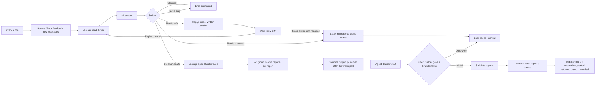

# Story 1. Bug report to Builder

**Prompt.** "Every five minutes check our feedback channels in Slack. If a message is a clear bug, hand it to Builder. If you can't understand or reproduce it, ask a question in the thread and pick up the answer next time. Group related bugs into one Builder task. Once Builder accepts, tell the reporter in their thread that Builder has started work on it and we will report back when it is merged."

**Goal.** Bug reports in Slack become Builder work with nobody triaging, and reporters are kept informed.

**Input.** New Slack messages in the configured feedback channel, and replies to questions this workflow asked. The source starts from the moment the workflow goes live: the first live run takes the newest message's time and nothing else, so what was already in the channel is never worked through, and a dry run shows a sample of the newest messages but stores nothing. A message a person already reacted to with the claim reaction (`eyes`) is never offered, and neither is anything this app posted itself: its notices and replies land in the channel it reads, and the Source leaves them out and counts them (`skippedOwn` on the step).

**Output.** For each clear bug, Builder has accepted a task, on a branch of Builder's own naming that the report records, and the reporter's thread says "Builder has started work on <report id>. We will report back when it is merged." The report becomes `automation_started`. Everything else ends one of four ways: a question was asked in the thread (and the answer is picked up later), the report was dismissed with a reason, a person was told, or it failed and is retried.

**Runs.** Every 5 minutes, up to 3 new reports per run; the rest wait in the queue for the next run. Waiting reports are re-checked every 15 minutes (the workflow's check cadence).

**Needs.** Slack, and Builder (the workspace's Builder connection and the Builder project connected to the repository, a workflow setting).

**Waits.** One: a reply to the question, up to 24 hours.

## The path

1. **`feedback` (Source, inbox poll):** new Slack messages, at most 3, skipping any a person claimed with `eyes` and any this app posted itself. No author filter is needed for that.
2. **`thread` (Lookup, `slack.readThread`):** reads the whole thread with its reactions and replies.
3. **`assess` (AI, per report):** reads the whole thread and answers `clearBug`, `enoughContext`, `question`, `risk`, `confidence`, `productUxImplications`, `alreadyClaimed`, `categories`, `reason`, against the rubric below.
4. **`route` (Switch):** the first route that fits, in this order.
   - **Already claimed by a person:** End `dismissed` (`dismissed`) with the reason.
   - **Needs info:** `ask` replies in the thread with a model-written question, then `waitReply` parks the report for up to 24 hours. A human reply (a bot never counts) sends it back to `thread` to be read and assessed again, once. A second reply, or 24 hours of silence, goes to `notifyOwner` (a Slack message to the triage owner) and End `manual` (`needs_manual`). A report is asked at most two questions.
   - **Not a bug:** End `dismissed` with the reason.
   - **Clear and safe** (clear bug, low risk, high confidence, no product or design question): continue to step 5.
   - **Otherwise** (clear but risky or uncertain): `notifyOwner`, End `manual`.
5. **`openTasks` (Lookup, `factory.listItems`):** the reports already handed to Builder, which the grouping step sees.
6. **`group` (AI, per report):** looks at this run's clear reports together, in one turn (up to 10), and answers once for each by its id with a `groupName` and the strictest gate values of its group: reports of the same defect or root cause share a name, at most 5 to a group. The model answers nothing else about a report: its title, thread, author and text stay the real report's, because the engine attaches only the declared fields to the report it came from and fails the report (`ai_invalid_output`, by field name) when a declared field is missing or the wrong kind. An answer that names a report that was not given, or answers one twice, is used by none of the reports in the batch. Anything else the model writes, such as a `thread` as text or a gate nested under another key, is dropped.
7. **`byGroup` (Combine, group by `groupName`, named after its first report):** one item per group, remembering which reports it stands for. The `groupName` only decides who goes together. The group's `key` and its item id come from the first report of the group in the order the reports arrived (`identity: firstMember`), so the same report always leads the same group whatever the model called it. The group reads like that first report (its real title, thread, author and text) and lists every member under `reports`.
8. **`startBuilder` (Agent, `builder.start`):** one start per group, asking for the branch `factory-<key>`, the first report's id, (Builder keeps a name of its own and returns it), attributed to the first reporter, with a model-written task and the gate inputs (`nodes.group`, the group's strictest values as the model gave them for its first report). The model is told to ask Builder for a regression test that fails before the fix and passes after it (or to say in the pull request why the code cannot be tested), and for proof the fix works under a `### Verified` heading in the pull request description: before and after screenshots or a recording of the running app for a bug a user can see, the test or command that proves it for one nobody can see. The gate is enforced in code inside the operation and cannot be edited from the canvas.
9. **`accepted` (Filter):** Builder's answer carries a branch name, the `externalRef` of the start's receipt. That is the name Builder kept, and it is never compared with the name asked for: Builder ignores the request, and every real start has come back under a name of its own. With a name, `reports` splits the group back into its reports, `tell` replies in each report's own thread, and End `handed` sets each report `automation_started` and records the returned branch. An answer with no branch name fails the item at this node (`expression_failed`) before anyone is told, and the reports go to `needs_manual` with nothing recorded; a blank name would take the `otherwise` port to End `manual`. The filter does not read `accepted`: an answer Builder did not accept never gets this far, because the step fails, and a start found already done has no `accepted` to read, because a receipt keeps only the fields that name a thing.

What the `assess` answers mean (each is also the field's description the model reads, and `builder.start` carries the same meanings on its gate fields):

- **`clearBug`:** true only when the report describes behavior that is wrong and the correct behavior is evident. A feature request, a question or an opinion is false.
- **`productUxImplications`:** true only when the fix needs a product or design decision: new or changed behavior, a choice between designs, wording that needs sign-off beyond restoring what was intended. It is false when the expected behavior is already clear and the fix restores it, including a UI or copy bug whose correct state is evident. A report being about the UI does not make it true.
- **`risk`:** low means a contained change with no data, auth, money or migration, judged from what the fix would touch and not from the reporter's own claim.
- **`confidence`:** high only when the report names the cause or the expected behavior and the repository would confirm it.
- **When unsure,** the model gives the cautious answer: `productUxImplications` true, risk higher, confidence lower. It never answers `clearBug` false just because it is unsure: a report too thin to judge sets `enoughContext` false and is asked instead, so a real bug is not dismissed.

## What it must never do, and where that is enforced

- **Hand Builder anything that is not a clear bug with low risk and high confidence.** Twice: the `clear` route lets only those through, and `builder.start` runs the dispatch gate in code (`server/lib/builder-dispatch-gate.ts`) before it contacts Builder; a refusal fails the item with `operation_not_allowed` and nothing is sent. The executor half is proved in `server/workflow-host/builder-operations.spec.ts` ("builder.start dispatch gate"), the story half here.
- **Tell a reporter "Builder has started" without a 202 and a branch name.** `tell` sits behind `accepted`, which reads the branch name from the start's receipt. A start that is refused, fails, or may not have happened never reaches it. The 202 half is the executor's: it returns a result only for an accepted start.
- **Start two Builder tasks for one group.** The duplicate guard is the start's receipt, not the branch name. Its key is the workflow's id, the group's item id (a hash of the id of the group's first report, never of the model's `groupName`), the node `startBuilder`, a round number (0 unless the item was released or sent back) and a hash of the reports in the group. It holds no run and no workflow version, so a new run, a workflow saved again and a requeue (which leaves receipts alone) all land on the same key. A `done` receipt is the answer: Factory reuses its status, branch and address and does not call Builder, and the item goes on through `accepted`, `tell` and `handed` as a fresh start would. A `started` receipt with no answer goes to a person and is never repeated. A `failed` one made no task, so the next attempt gets a new key. `builder-start-receipt.spec.ts` replays the first live hand-off, a start accepted and refused by an older graph, and shows the requeued report reaching the start again without a second call to Builder; it also requeues one report under four different `groupName`s and finds the same group id, the same receipt key and one call to Builder in all of them. The branch name guards nothing: `builder.start` looks the asked name up before starting, and again after a timeout (`builder-operations.spec.ts`: "looks the branch up before starting, so a retry never makes a second one", "is maybe when it cannot tell whether the branch was made"), but Builder renames branches, so that lookup never finds a task it renamed.
- **What that guard does not cover.** The key follows who is in the group, in the order they arrived. The model no longer writes the key, so whatever it calls a group, one report requeued alone, or requeued with the same reports in the same order, lands on the same key and cannot start a second task. A report that comes back in a different group does not: a requeued report that is now grouped with a report that arrived in the same run, or that the model now splits from its group, has a different member list (and a different leader when the other report came first), so it has a different key and starts a task of its own. The reports are in the order the source offered them, which is oldest first for Slack; the same reports offered in another order name the group after another first report. A workflow deleted and created again, or a `startBuilder` node renamed, begins with no receipts. Requeue one report at a time.
- **Ask more than two questions, or the same one twice.** The loop sends a report back once, so a report gets its first question and at most one more. That the second question differs from the first is the model's instruction; no code can check prose.
- **Treat a bot message as a reply.** The host's thread reader drops bots (`server/workflow-host/thread-reader.spec.ts`: "counts human messages after the wait began and drops bots, the root, and earlier messages"); the scenario shows the engine leaves the report waiting.
- **Group across repositories, or put more than 5 in a group.** The model is told the limits. Nothing in code enforces either: the answers are checked for their declared fields, not for group size. Reports are grouped with the others in their batch of 10; with more than 10 clear reports in one run, a second batch is a second turn, and two batches that both say `pay-button` end up in one group.
- **Let the model change what a report says or where its thread is.** The grouping answer is attached to each report by id, only for the declared fields, and `title`, `thread`, `author`, `text` and `url` come from the report. `group-answers.spec.ts` gives the step a thread written as text, a rewritten title and author, a gate nested under another key, a report with no entry, a gate field of the wrong kind, an answer naming a report that was not given and an answer for one report twice: the first is ignored and the reporters are told in their real threads; the others fail the report or the batch by name (`ai_invalid_output`), set it aside twice and then hand it to a person, and Builder is not called for it. The model's strictest gate values are still the model's: nothing in code checks that every report of a group carries the same ones, and `startBuilder` reads the first report's.
- **Read its own notice as a new report.** The poll asks the Slack reader who the app is (its bot user, bot and, from its posts, Slack app) and leaves out any post that names one of them: a channel notice, a reply the channel also shows, an edit or a delete of either. They still move the position and are counted in `skippedOwn` on the step. Another app's bot and a person are read as before. When the app cannot learn who it is the run fails with `identity_unresolved` and takes nothing. The host half is proved against a fake Slack in `server/workflow-host/own-posts.scenario.spec.ts`, the story half by the scenario `the-loops-own-notice-is-not-a-second-report`. `includeOwnPosts: true` on the Source's filter reads them anyway, for a workflow that chains on another workflow's posts; nothing in the canvas sets it yet.
- **Hand the same report to Builder twice.** A handed-off report is no longer offered. If it were offered again, the start and the reply are already under done receipts and are not repeated.

## Not in this version

- A report related to a task Builder already has joining that task with a "this looks related" reply. The model sees the open tasks (`openTasks`), but nothing routes on what it says.
- A Slack message to the triage owner when a start fails. A report whose start is refused lands in `needs_manual` at once with the reason, visible in Items, and no message is sent; a failure that may pass (Slack down on the reply) is set aside and tried again after 5 and then 10 minutes, and the third failure hands the report to a person.
- The recorded Builder task has only run in memory since the fix. Handing a report off sets `automation_started` and, through the `handed` End's `record`, writes four fields on the report's row: `builderTaskId` as `projectId:branchName`, `projectId` from the `builderProjectId` setting, `branchName` from the start's `externalRef` (the name Builder returned), and `repository` from the workflow settings. `expect.json` asserts all four under `recorded`, and `server/workflow/stories/handoff.spec.ts` builds story 2's input from them, with a renamed branch too. The first live hand-off started a real Builder task, Builder kept its own branch name, and the graph then refused it, so the report was never announced or recorded; this version follows the returned name, and no live run of it has finished yet.
- The model's judgment of the `assess` answers is not measured. The scenarios script them, so they prove the routing and the gate, not that the model reads a UI bug as a plain bug. `fixtures/assess-calibration.json` holds 10 labelled synthetic reports (a UI bug with an evident correct state, a copy flip, a label change, a feature request, a vague complaint, a bug with two possible fixes, a typo, an auth bug, a duplicate, a claimed report) for a later live comparison; `server/lib/bug-assess-calibration.spec.ts` checks that the file is well formed and agrees with the gate, and nothing runs it against a model yet.
- Builder following the ask. The task wording asks for the test and the `### Verified` block, and story 2's merge gate refuses a pull request whose description has no Verified section or whose code change has no test change (`no_verification_evidence`, `no_regression_test`), so a pull request without them goes to a person instead of merging. The scenarios here script the model's answer and no real Builder pull request has run through the gate, so none shows Builder doing it.

## Scenarios

- `a-clear-bug-goes-to-builder-and-the-reporter-is-told`: the whole happy path, with the gate inputs the start receives.
- `missing-info-asks-waits-is-woken-and-assessed-again`: ask, park, two replies at once wake it once, read again, hand off.
- `gives-up-after-two-questions`: the second reply leaves by Limit reached, the owner is told, no third question.
- `nobody-answers-for-24-hours`: re-checks every 15 minutes, times out at 24 hours, the owner is told.
- `a-bot-message-is-not-a-reply`: a bot in the thread does not wake the report.
- `a-thread-that-cannot-be-read-is-not-an-empty-thread`: a failed read at the deadline (Slack down) is not a timeout and spends no attempt; the report keeps waiting.
- `each-route-ends-where-the-story-says`: not a bug, risky, and claimed reports; none reaches Builder.
- `two-related-reports-become-one-task`: two reports one start, a third its own; each thread told once.
- `a-group-answer-that-misstates-the-report-changes-nothing`: the grouping answer adds the thread as text, a new title and author and a nested gate beside the declared fields; the start is for the branch of the real report, its author, and the reporter is told in the real thread.
- `a-group-answer-with-the-gate-nested-fails-the-report-and-starts-nothing`: the gate is nested and none of the declared fields is there; the report fails at `group` by name, is retried twice and goes to a person; Builder is not called and nobody is told.
- `a-start-on-a-branch-builder-renamed-is-announced-and-tracked-under-the-returned-name`: Builder keeps its own branch name; the reporter is told once, the report is `automation_started` with the returned name recorded, and offering it again finds the start done and starts nothing.
- `a-start-builder-did-not-accept-is-not-announced`: an answer that says it was not accepted and has no branch name stops at `accepted` with `expression_failed`; nothing is announced or recorded, the report goes to a person at once, and nothing starts again.
- `a-refused-start-fails-the-item-and-nobody-is-told`: the gate refuses; the report goes to a person at once and is not tried again.
- `a-timed-out-start-is-never-retried-blind`: a start that may have happened is not started again.
- `a-tick-that-dies-after-asking-never-asks-twice`: a started receipt stops a second question.
- `a-failed-tell-is-retried-without-starting-builder-again`: the reply failed after Builder started (Slack down); five minutes on it is told, and Builder is not started again.
- `a-parked-report-is-found-again-after-a-restart`: the process restarts while a report waits.
- `the-same-group-offered-again-is-not-started-twice`: done receipts stop a second start and a second reply.
- `a-dry-run-asks-nothing-and-parks-nothing`: a dry run sends no question and writes nothing.
- `a-first-live-run-starts-from-now-and-the-next-picks-up-the-new-bug`: the first live run takes the newest position and nothing else (no question, no Builder task, and a `primed` count on the run so it is not read as an empty channel); the next run goes on from that position and hands the new bug to Builder. The host half, that history is never ingested, is proved against a channel of 200 messages in `server/workflow-host/first-poll-prime.scenario.spec.ts`.
- `the-loops-own-notice-is-not-a-second-report`: a risky report goes to the triage owner as a Slack message; when that message lands in the channel the Source reads, the next run leaves it out, says so on the step, and assesses, asks and starts nothing for it. The recorded answer is the host's, so what it scripts is the engine's side; the real poll is in the host spec above.
