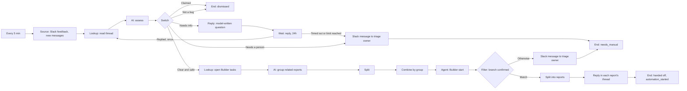

# Story 1. Bug report to Builder

**Prompt.** "Every five minutes check our feedback channels in Slack. If a message is a clear bug, hand it to Builder. If you can't understand or reproduce it, ask a question in the thread and pick up the answer next time. Group related bugs into one Builder task. Once Builder accepts, tell the reporter in their thread that Builder has started work on it and we will report back when it is merged."

**Goal.** Bug reports in Slack become Builder work with nobody triaging, and reporters are kept informed.

**Input.** New Slack messages in the configured feedback channel, and replies to questions this workflow asked. A message a person already reacted to with the claim reaction (`eyes`) is never offered.

**Output.** For each clear bug, Builder has accepted a task on a branch named for its group, and the reporter's thread says "Builder has started work on <report id>. We will report back when it is merged." The report becomes `automation_started`. Everything else ends one of four ways: a question was asked in the thread (and the answer is picked up later), the report was dismissed with a reason, a person was told, or it failed and is retried.

**Runs.** Every 5 minutes, up to 5 new reports per run. Waiting reports are re-checked every 15 minutes (the workflow's check cadence).

**Needs.** Slack, and Builder (the workspace's Builder connection and the Builder project connected to the repository, a workflow setting).

**Waits.** One: a reply to the question, up to 24 hours.

## The path

1. **`feedback` (Source, inbox poll):** new Slack messages, at most 5, skipping any a person claimed with `eyes`.
2. **`thread` (Lookup, `slack.readThread`):** reads the whole thread with its reactions and replies.
3. **`assess` (AI, per report):** `clearBug`, `enoughContext`, `question`, `risk`, `confidence`, `productUxImplications`, `alreadyClaimed`, `categories`, `reason`.
4. **`route` (Switch):** the first route that fits, in this order.
   - **Already claimed by a person:** End `dismissed` (`dismissed`) with the reason.
   - **Needs info:** `ask` replies in the thread with a model-written question, then `waitReply` parks the report for up to 24 hours. A human reply (a bot never counts) sends it back to `thread` to be read and assessed again, once. A second reply, or 24 hours of silence, goes to `notifyOwner` (a Slack message to the triage owner) and End `manual` (`needs_manual`). A report is asked at most two questions.
   - **Not a bug:** End `dismissed` with the reason.
   - **Clear and safe** (clear bug, low risk, high confidence, no product or design question): continue to step 5.
   - **Otherwise** (clear but risky or uncertain): `notifyOwner`, End `manual`.
5. **`openTasks` (Lookup, `factory.listItems`):** the reports already handed to Builder, which the grouping step sees.
6. **`group` (AI, whole list):** looks at this run's clear reports together and answers one entry per report with a `groupId`: reports of the same defect or root cause share one, at most 5 to a group. Each entry repeats the report's title, thread and author and carries the strictest gate values of its group. `split` turns the answer back into one item per report.
7. **`byGroup` (Combine, group by `groupId`):** one item per group, remembering which reports it stands for.
8. **`startBuilder` (Agent, `builder.start`):** one start per group, on the branch `factory-<groupId>`, attributed to the first reporter, with a model-written task summary and the gate inputs. The gate is enforced in code inside the operation and cannot be edited from the canvas.
9. **`accepted` (Filter):** Builder's answer names the branch that was asked for. If it does, `reports` splits the group back into its reports, `tell` replies in each report's own thread, and End `handed` sets each report `automation_started`. If it names another branch, `unconfirmed` and `warnOwner` tell the triage owner and the reports go to End `manual`: nothing is announced and nothing is started again by itself.

## What it must never do, and where that is enforced

- **Hand Builder anything that is not a clear bug with low risk and high confidence.** Twice: the `clear` route lets only those through, and `builder.start` runs the dispatch gate in code (`server/lib/builder-dispatch-gate.ts`) before it contacts Builder; a refusal fails the item with `operation_not_allowed` and nothing is sent. The executor half is proved in `server/workflow-host/builder-operations.spec.ts` ("builder.start dispatch gate"), the story half here.
- **Tell a reporter "Builder has started" without a 202 and a branch name.** `tell` sits behind `accepted`, which reads the branch name from the start's receipt. A start that is refused, fails, or may not have happened never reaches it. The 202 half is the executor's: it returns a result only for an accepted start.
- **Make two branches for one group.** The branch is `factory-<groupId>`, and the model is told a `groupId` is the id of the group's first report, so a report keeps its branch from one attempt to the next. The start is under a receipt, so a start that may already have happened (`started` with no answer) goes to a person and is never repeated; `builder.start` also looks the branch up by name before starting, and again after a timeout (`builder-operations.spec.ts`: "looks the branch up before starting, so a retry never makes a second one", "is maybe when it cannot tell whether the branch was made").
- **Ask more than two questions, or the same one twice.** The loop sends a report back once, so a report gets its first question and at most one more. That the second question differs from the first is the model's instruction; no code can check prose.
- **Treat a bot message as a reply.** The host's thread reader drops bots (`server/workflow-host/thread-reader.spec.ts`: "counts human messages after the wait began and drops bots, the root, and earlier messages"); the scenario shows the engine leaves the report waiting.
- **Group across repositories, or put more than 5 in a group.** The model is told the limits. Nothing in code enforces either: the whole-list answer is checked for its declared fields, not for group size.
- **Hand the same report to Builder twice.** A handed-off report is no longer offered. If it were offered again, the start and the reply are already under done receipts and are not repeated.

## Not in this version

- A report related to a task Builder already has joining that task with a "this looks related" reply. The model sees the open tasks (`openTasks`), but nothing routes on what it says.
- A Slack message to the triage owner when a start fails. A report whose start is refused lands in `needs_manual` at once with the reason, visible in Items, and no message is sent; a failure that may pass (Slack down on the reply) is set aside and tried again after 5 and then 10 minutes, and the third failure hands the report to a person.
- The task id handed to story 2. Handing a report off sets `automation_started` only. Story 2 reads the Builder task from `item.extras.builderTaskId`, `projectId`, `branchName` and `repository`, which nothing records yet: the host must write those four fields on each report's row when it sets `automation_started` (here: `projectId` and `branchName` from the start's answer, `builderTaskId` as `projectId:branchName`, `repository` from the workflow settings).

## Scenarios

- `a-clear-bug-goes-to-builder-and-the-reporter-is-told`: the whole happy path, with the gate inputs the start receives.
- `missing-info-asks-waits-is-woken-and-assessed-again`: ask, park, two replies at once wake it once, read again, hand off.
- `gives-up-after-two-questions`: the second reply leaves by Limit reached, the owner is told, no third question.
- `nobody-answers-for-24-hours`: re-checks every 15 minutes, times out at 24 hours, the owner is told.
- `a-bot-message-is-not-a-reply`: a bot in the thread does not wake the report.
- `a-thread-that-cannot-be-read-is-not-an-empty-thread`: a failed read at the deadline (Slack down) is not a timeout and spends no attempt; the report keeps waiting.
- `each-route-ends-where-the-story-says`: not a bug, risky, and claimed reports; none reaches Builder.
- `two-related-reports-become-one-task`: two reports one start, a third its own; each thread told once.
- `a-start-confirmed-on-another-branch-is-never-announced`: nothing is announced, the owner is warned.
- `a-refused-start-fails-the-item-and-nobody-is-told`: the gate refuses; the report goes to a person at once and is not tried again.
- `a-timed-out-start-is-never-retried-blind`: a start that may have happened is not started again.
- `a-tick-that-dies-after-asking-never-asks-twice`: a started receipt stops a second question.
- `a-failed-tell-is-retried-without-starting-builder-again`: the reply failed after Builder started (Slack down); five minutes on it is told, and Builder is not started again.
- `a-parked-report-is-found-again-after-a-restart`: the process restarts while a report waits.
- `the-same-group-offered-again-is-not-started-twice`: done receipts stop a second start and a second reply.
- `a-dry-run-asks-nothing-and-parks-nothing`: a dry run sends no question and writes nothing.
