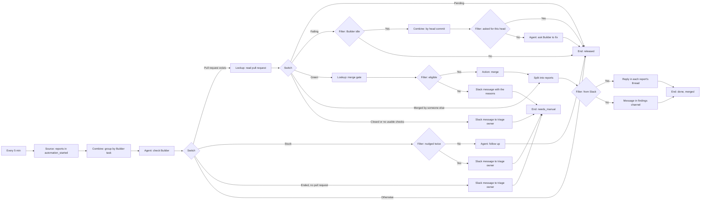

# Story 2. Builder to merge

**Prompt.** "Every five minutes look at everything we've handed to Builder. Check whether Builder is working or stuck, and nudge it or tell a person if it's stuck. When Builder opens a pull request, watch it: if it's green, merge it. If not, ask Builder to fix it again. When it merges, tell the reporter's Slack thread."

**Goal.** Work handed to Builder gets finished: Builder is not forgotten or stuck, its pull request reaches a merge, and the reporters hear about it.

**Input.** Reports in `automation_started`: every report story 1 handed off and every item another story handed to Builder (story 8). Each carries its Builder task in `extras`: `builderTaskId`, `projectId`, `branchName` and `repository`. Nothing writes those four fields yet, so a real handed-off report cannot be read by this story until the host records them when it sets `automation_started` (see "Not in this version").

**Output.** The pull request is merged and each report is told, in its own Slack thread (or in the findings channel when it did not start in Slack), with the link. A report whose pull request is merged becomes `merged`. If anything blocks that (a failing rule of the merge gate, such as no approving review), the triage owner is told with the reason, and the report ends `needs_manual`.

**Runs.** Every 5 minutes. Up to 50 reports per run.

**Needs.** Builder, GitHub (read pull requests and merge), Slack, and a findings channel (a workflow setting) for merge notices on reports that did not start in Slack.

**Waits.** None. Each run re-checks every report and acts on what it finds, so "waiting" is releasing the report until the next run.

## The path

1. **`inFlight` (Source, status):** reports in `automation_started`.
2. **`byTask` (Combine, group by `builderTaskId`):** one item per Builder task, so a task with several reports is checked once.
3. **`check` (Agent, `builder.check`):** one read of the branch: its state (`working`, `stuck`, `completed`, `failed`), whether a pull request exists, its number and its repository. A pull request in a repository other than the workflow's `repository` setting fails the check (`builder_pr_repository_mismatch`), so its number is never read as a pull request of this repository.
4. **`state` (Switch):**
   - **Pull request exists:** continue to step 5, whatever Builder is doing.
   - **Stuck:** `nudgedTwice` looks at how often this task was nudged. Under two: `nudge` sends "status? continue" through `builder.followUp` and releases the task. Twice already: `alert` tells the triage owner and End `manual`.
   - **Ended with no pull request** (the branch is gone or Builder finished with nothing to review): `lost` tells the triage owner and End `manual`.
   - **Otherwise** (working, no pull request yet): End `keep` (released): look again in 5 minutes.
5. **`readPr` (Lookup, `github.readPullRequest`):** its state, the checks on its head commit as counts, review threads, size.
6. **`ci` (Switch):**
   - **Merged by someone else:** straight to step 7.
   - **Closed unmerged:** `person` tells the triage owner and End `manual`.
   - **Pending checks:** End `keep`.
   - **Failing checks:** `builderIdle` skips the follow-up while Builder is working. Otherwise `byHead` groups the task by its head commit and `askedForHead` checks whether that commit was already sent back: if so End `keep`; if not `fix` sends Builder a model-written message naming the failing checks (a follow-up) and End `keep`.
   - **Green** (every check passing, complete coverage): `gate` (`factory.mergeGate`) and `eligible`. Eligible: `merge` (`github.mergePullRequest`). Not eligible: `refused` tells the triage owner every reason and End `manual`. A green pull request nobody has approved is not eligible, so it goes to a person at once rather than waiting for the approval.
   - **Otherwise** (no checks, partial coverage): `person`, End `manual`.
7. **`reports` (Split):** the task back into its reports. **`inSlack` (Filter):** a report that came from Slack gets `tellReports`, a reply in its own thread; any other report gets `tellFindings`, a message in the findings channel. End `done` sets each report `merged`.

## What it must never do, and where that is enforced

- **Merge without every check green on the current head commit, an unresolved review thread, an approving review, or the merge gate saying yes.** Three layers: `ci` sends only a pull request whose checks are all passing to `gate`; `eligible` sends only an eligible one to `merge`; and `merge-factory-pull-request` re-runs the gate itself, pinned to the head commit it checked, so a graph rewired around the gate still cannot merge (`actions/merge-factory-pull-request.spec.ts`: "re-runs the gate itself, so a graph that skipped the gate node still cannot merge an ineligible pull request"). The rules are in `server/lib/factory-merge-gate.ts` (`factory-merge-gate.spec.ts`: checks, review threads, approvals, size, never-automate paths).
- **Merge a pull request Builder did not author.** Builder's accounts for a merge are exactly `builderio-bot` and `builder-io-integration[bot]` (`BUILDER_MERGE_AUTHOR_LOGINS`, matched whole and ignoring case); the other names the babysit code treats as bots (`builder-io-bot`, `builderio-bot[bot]`, ...) and lookalikes such as `builderio-bot2` are refused (`factory-merge-gate.spec.ts`; `merge-factory-pull-request.spec.ts`: "refuses a pull request a person opened, even when everything else is green"). A login alone is not proof of who opened it, so the gate also refuses a pull request whose branch is in a fork (or in a repository GitHub no longer has) and one aimed at any branch but the repository's default (`factory-merge-gate.spec.ts`), and checks the author's GitHub id once `BUILDER_PULL_REQUEST_AUTHOR_IDS` lists the verified Builder accounts.
- **Merge a pull request no person with write access has approved.** The gate needs one approving review whose reviewer is a person with an owner, member or collaborator association (GitHub's `author_association`), is not the pull request's author, is not a bot (a `[bot]` login or a `Bot` user type) or one of Builder's own accounts, whose latest review that is not a comment is that approval, and that was given on the current head commit. A later request for changes or a dismissal cancels it, a comment does not, and a push after the approval needs a new one. Without one the gate answers `approval_required` with counts (approvals seen, on an earlier commit, from bots, from non-collaborators, by the author) and the merge is held (`factory-merge-approval.spec.ts`, `factory-merge-gate.spec.ts`; scenario `a-green-pull-request-without-a-current-approval-is-held-for-a-person`). A review list GitHub gives only in part is `reviews_incomplete`, never a missing approval. GitHub's own branch protection can still refuse the merge afterwards (`merge_not_allowed`).
- **Nudge Builder while it is working, or more than once per head commit.** `builderIdle` keeps a follow-up from going out while the branch is `working`; `askedForHead` counts follow-ups per head commit, because `byHead` makes one item per head and the follow-up counter lives on that item. A stuck task is nudged at most twice by the same counter on the task's own item.
- **Tell a reporter "merged" without a confirmed merge.** `reports` is reached only after GitHub says the pull request is merged or the merge action answered under a receipt. A merge whose outcome is unknown goes to a person and is never sent again.
- **Notify a thread twice.** Each report's reply is under a receipt of its own, so after a partial failure the next tick tells only the thread that was missed and does not merge again.

## Not in this version

- **The Builder task is not recorded when a report is handed off.** Stories 1 and 8 set `automation_started` and nothing else, so no row carries `builderTaskId`, `projectId`, `branchName` or `repository`, and this story fails on a real handed-off report at `byTask` (the path has no value). The host must write four fields on each report's row at handoff: `projectId` and `branchName` from the start's answer, `builderTaskId` as `<projectId>:<branchName>`, and `repository` from the workflow settings. The fixtures here carry them as if it did.
- **A cap of six fix rounds**, then a person. The follow-up counter is per head commit, so a task whose every new head fails is sent back for each one without end. The merge gate and a person still stand between a green pull request and the base branch.

## Scenarios

- `a-working-task-is-checked-once-for-its-reports-and-left-alone`: two reports, one check, nothing sent.
- `a-stuck-task-is-nudged-twice-then-escalated`: two nudges, then the triage owner is told and both reports go to a person.
- `a-failing-pull-request-is-sent-back-once-per-head-commit`: one follow-up per head commit and none while Builder works.
- `pending-checks-wait-without-a-nudge-or-a-merge`
- `a-green-pull-request-is-merged-and-every-thread-is-told-once`
- `a-green-pull-request-that-fails-the-merge-gate-is-not-merged`
- `a-green-pull-request-without-a-current-approval-is-held-for-a-person`: the gate answers `approval_required` (the only approval is on an earlier commit); the triage owner is told and both reports go to a person.
- `a-pull-request-merged-by-someone-else-goes-straight-to-the-threads`
- `a-closed-pull-request-goes-to-a-person`
- `a-pull-request-with-no-checks-goes-to-a-person`
- `a-task-that-ended-without-a-pull-request-goes-to-a-person`
- `an-unreadable-task-is-never-read-as-working`: a read that cannot succeed is never taken for working or done; the reports go to a person at once.
- `a-failed-reply-is-retried-and-the-merge-is-not-repeated`: Slack is down for one thread's reply; five minutes on only that thread is told and nothing is merged again.
- `a-merge-that-may-have-happened-is-never-repeated`
- `a-merged-fix-for-an-alert-is-announced-in-the-findings-channel`: a report with no Slack thread.
- `a-dry-run-merges-nothing`
- `a-test-of-one-node-reads-but-writes-nothing`: the test step runs one node.
