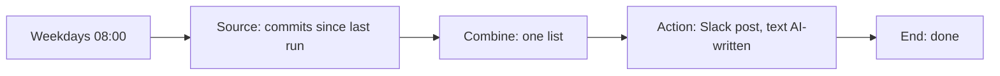

# Story 3. Morning digest

**Prompt.** "Every weekday at 8, send the team a short summary of what changed in the repo since the last one."

**Goal.** Every morning the team gets one short summary of what changed in the repository since the last digest, so nobody reads the commit log.

**Input.** The repository's commits since the previous scheduled run. On Monday that means since Friday morning.

**Output.** One Slack message in the digest channel with a TL;DR and links. With no commits the message says "No commits since the last digest."

**Runs.** Weekdays at 08:00 in the workflow's timezone (America/New_York in the shipped graph).

**Needs.** GitHub (read commits) and Slack (post a message).

**Waits.** None.

## The path

1. **`commits` (Source, window):** reads the repository's commits from the previous scheduled instant to this one. The window comes from the schedule, so a retried or late run reads the same span. At most 100 commits are taken; when the provider had more, the step records how many (`truncatedFrom`) and the next node is told.
2. **`digest` (Combine, list):** folds every commit into one item holding the list (author, first line, link), a `count`, `truncated` and `totalAvailable`. With no commits it is still one item with `count: 0`, so a quiet morning can say so.
3. **`post` (Action, `slack.postMessage`):** posts to the digest channel. The text is written by the model from the list: a TL;DR, at most five bullets by area, notable authors, links, the exact sentence for an empty list, and how many of how many commits are shown when the list was cut.
4. **`done` (End, done).**

## What it must never do, and where that is enforced

- **Read a commit outside its window.** The window is computed from the schedule and the last time the Trigger fired (`engine/window.ts`), and the scenarios assert the span of each read.
- **Post twice for one morning.** The tick is keyed by its scheduled instant, so a redelivered tick finds its work done and does nothing; the post is also under a receipt keyed by the item.
- **Hide a cut-off.** The source step records `truncatedFrom`, and the list the model reads says `truncated: true` and the true total. That the model then says so is its instruction; no code can check prose.
- **Move the window on a failed morning.** The last-trigger time is saved only when the whole run completes, so after a failure the next digest still starts at the last good one.

## Not in this version

- Telling the owner by Slack when GitHub is still failing at 10:00. A failed morning is a failed run, visible in Activity and retried by the next scheduled tick.
- Sending the digest by email instead of Slack: build it by swapping `post` for `email.send`.

## Scenarios

- `monday-reads-friday-to-monday-and-posts-once`: the Monday window, one post, and a redelivered tick that does nothing.
- `tuesday-starts-where-monday-ended`: consecutive windows with no gap and no overlap.
- `a-quiet-morning-still-posts-a-count-of-zero`: no commits, still one message.
- `a-cut-off-list-says-how-much-was-cut`: 100 taken of 340, recorded and passed on.
- `github-down-then-back-covers-the-missed-morning`: a failed run posts nothing and the next window reaches back to the last good run.
- `a-dry-run-posts-nothing`: the dry run reads and writes the message but sends nothing.
