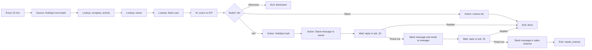

# Story 4. Hot-lead routing with SLA escalation

**Prompt.** "When a new lead arrives in HubSpot, score it against our ideal customer. If it's hot, create a task for the owner, message them in Slack, and if they don't acknowledge in two hours tell their manager. If still nothing, post in the sales channel. Warm leads go to the nurture list."

**Goal.** Every new sales lead is scored, the owning rep is told fast when the lead is hot, and the manager is told when the rep does not respond in time.

**Input.** New HubSpot leads (contacts in the Lead stage) since the last run, one item per lead.

**Output.** For a hot lead: a HubSpot task for the owner, a Slack message to the owner saying why the lead is hot, and, if the owner does not acknowledge within 2 hours, a Slack message and an email to the manager. A second miss (2 more hours) posts in the sales channel and ends the lead `needs_manual`. A warm lead is added to the nurture list. A cold lead is dismissed with the reason. This story is internal only: nothing is ever sent to the lead.

**Runs.** Every 15 minutes. Waiting leads are looked at on the workflow's check cadence (15 minutes).

**Needs.** HubSpot (read leads, owners and company details; create tasks; add to a list), Slack (find a person by email, post), and the workspace email sender.

**Waits.** Two, chained. The first waits up to 2 hours for the owner (a reply in the Slack thread, or the check-mark reaction). The second waits up to 2 more hours for the owner or the manager.

## The path

1. **`leads` (Source, provider query):** HubSpot leads past the saved cursor, newest first, up to 50 a run. Each lead gets a row in Factory's inbox so it can end with a status, and is taken under a lease. A lead already ended, or waiting at a Wait, is not taken again if the source offers it again.
2. **`enrich` (Lookup):** the lead's company and recent activity.
3. **`ownerRecord` (Lookup):** the lead's HubSpot owner, for their email.
4. **`owner` (Lookup):** the owner's Slack user, found by that email.
5. **`score` (AI, per item):** `tier` (hot, warm, cold), `summary`, `reason`, against the ideal customer profile.
6. **`tier` (Switch):**
   - **Hot:** `task` creates the HubSpot task (due today, owner, contact), `tellOwner` messages the owner (AI-written, says why the lead is hot), and `ack1` waits 2 hours for an answer from the owner in that message's thread. A reply or the ack reaction goes to `done`. Silence goes to `mgrSlack` and `mgrEmail`, then `ack2`, which waits 2 more hours for the owner or the manager (by email). An answer goes to `done`. Silence goes to `salesChannel` and `manual` (End `needsManual`).
   - **Warm:** `nurture` adds the lead to the nurture list, then `done`.
   - **Cold (Otherwise):** `dismissed` (End `dismissed`, reason = the score's reason).

## What it must never do, and where that is enforced

- **Message the same lead twice, or create a duplicate task.** The task and each message are writes under a receipt keyed by the lead and the node, so a repeat visit finds the receipt done and calls nothing. A lead waiting at a Wait, or already ended, is also not taken again (`engine/nodes/source.ts`, the lease and the row's state); scenarios offer the lead on every tick to show it.
- **Escalate after an acknowledgement.** The Wait reads the thread before it looks at its deadline, so an answer given in time wins even when the look is late. Who counts is the Wait's `acceptFrom` (the owner for the first wait, the owner or the manager for the second); the thread reader drops bots and everyone else (`workflow-host/thread-reader.ts`).
- **Contact the lead.** No node addresses the lead: every message goes to the owner, the manager or the sales channel, and the only email goes to the manager. A spec checks the recipient of every write in every scenario.
- **Read an unreadable lookup as "no owner".** A failed Slack lookup fails that lead at `owner`: no task, no message. A lookup that cannot succeed (no such person) hands the lead to a person at once; one that may pass (Slack unavailable) is set aside and tried again after 5 and then 10 minutes, and the third failure hands it to a person.

## Not in this version

- A lead with no HubSpot owner uses no default owner: it fails at `ownerRecord` because the owner id is missing. A default-owner setting is not wired.
- An owner with no Slack account is a failed lookup, not a fallback to email.
- Business-hours SLAs: both waits run on wall-clock time.
- A failed lead does not depend on its source offering it again. HubSpot leads come by cursor and the cursor moves past a lead once the run completes, so a failed lead is either handed to a person at once or set aside at the failing step (see the last scenario).

## Scenarios

- `owner-replies-in-the-thread-and-nothing-escalates`: one task, one message, the owner answers, nothing else is sent.
- `the-ack-reaction-counts-as-an-answer`: the check-mark reaction acknowledges the lead.
- `a-late-tick-still-counts-an-answer-given-in-time`: an answer at 1h50 is honored by a look at 2h10.
- `nobody-answers-so-the-manager-is-told-and-then-the-sales-channel`: both escalations, in order, once each, ending `needs_manual`.
- `the-manager-answers-the-second-wait`: the manager ends the second wait, so the sales channel hears nothing.
- `strangers-and-bots-do-not-count-as-an-answer`: a stranger's reply and a bot's message answer neither wait.
- `three-leads-take-three-routes`: hot, warm and cold in one run.
- `a-lead-offered-again-is-not-processed-twice`: the same lead offered while waiting and after it ended.
- `a-failed-slack-lookup-is-a-failure-and-not-no-owner`: the lookup finds nobody; nothing sent, a person at once.
- `a-failed-lead-behind-a-cursor-is-retried-and-then-handed-to-a-person`: Slack is down; the cursor has moved on; the lead is tried again after 5 and then 10 minutes and the third failure hands it to a person.
