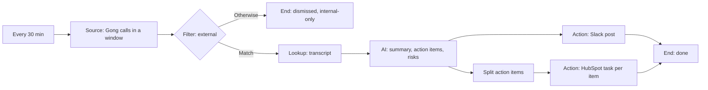

# Story 5. After every customer call

**Prompt.** "After each customer call in Gong, post a summary, action items, and risks in Slack and create a HubSpot task for each action item."

**Goal.** After each customer call recorded in Gong, the account team has the summary, action items and risks in Slack, and a follow-up task exists for each action item, without anyone writing notes.

**Input.** The calls Gong recorded since the last run (a window of the last 30 minutes, then each run picks up where the last one ended), with the transcript of each external call.

**Output.** One Slack post per external call in the calls channel (summary, action items, risks and next step), and one HubSpot task per action item. Internal-only calls are dismissed with the reason "Internal-only call" and their transcripts are never read.

**Runs.** Every 30 minutes.

**Needs.** Gong (vault key), HubSpot and Slack.

**Waits.** None.

## The path

1. **`calls` (Source, window):** `gong.newCalls` for the span from the last run to this one, up to 50 calls. Calls are kept inline in the run, not as inbox rows.
2. **`external` (Filter):** `scope` equals `External` goes on; anything else goes to `internalOnly` (End, dismissed, "Internal-only call"). A call whose scope is `Unknown` is treated as internal.
3. **`transcript` (Lookup, `gong.transcript`):** reads the transcript. It is a POST that only reads, so the operation declares itself a read. A read that returns nothing at all is a failed lookup, never an empty transcript.
4. **`extract` (AI, per call, input budget 20,000 tokens):** returns `summary`, `actionItems` (a list of `{text, owner, due}`), `risks` and `nextStep`, in its own words: its instruction allows no more than five consecutive transcript words in any field and no quotation marks.
5. Two branches from `extract`:
   - **`post` (Action, `slack.postMessage`)** to the calls channel. The text is written by the model from the extracted fields.
   - **`splitItems` (Split)** the action items into one item each, then **`task` (Action, `hubspot.createTask`)**: the title is the action item's text, and the notes carry the likely owner, the suggested due date and the summary. Both branches end in `done`.

## What it must never do, and where that is enforced

- **Create the same task twice.** Every task is a write under a receipt keyed by the call and the item's position (`call-1#0`), so a run that is repeated finds the first task's receipt. One that is `done` is reused; one that was started and never confirmed is held for a person instead of being created again. Enforced by the engine's receipts; the crash scenario proves it.
- **Post twice for one call.** Same receipt, keyed by the call.
- **Process an internal-only call.** The `external` filter runs before any transcript is read; the transcript is fetched once per external call.
- **Pass the model's guess as a HubSpot owner id.** The shipped graph does not bind `ownerId`: the model can only name a person as said on the call, so the likely owner goes into the task notes and HubSpot assigns the task by its own rule. (The first draft bound it, and `create-hubspot-task` takes an id of at most 20 characters.)
- **Post transcript text.** Not enforced by code. The post is written by a model that is handed the whole item, transcript included, and the engine sends whatever text it returns; the guard is the instructions of the two models involved (`extract`: own words, at most five consecutive transcript words, no quotation marks; `post`: "summaries only", "never quote the transcript"). A real-model check found one of six extract answers copying a ten-word passage into a risk, because the instruction then covered only the summary. The scenario `a-post-that-quotes-the-transcript-is-sent-because-no-code-reads-the-text` keeps the gap visible. Closing it needs a way to drop a lookup result before a node (or a model-facing view of the item), which no node kind does today.

## Not in this version

- A call whose transcript is not ready yet is not retried for six hours. The transcript read is retried within the run; a read that still fails for a reason a later try may fix sets the call aside at that step and tries it again after 5 and then 10 minutes, and a read that cannot succeed hands the call to a person at once. The plan's "retry for up to 6 hours" is not built.
- A very long transcript is cut at the node's input budget by the AI runner, and the run records that on the step (`inputTruncated`). The post does not say so.
- A mention of the account owner in the post (there is no owner lookup in the graph), and the call's link in the post unless the model adds it from the item.

## Scenarios

- `an-external-call-gets-one-post-and-one-task-per-action-item`: an external and an internal call; one post, two tasks, the internal call dismissed without its transcript being read.
- `a-call-with-no-action-items-posts-and-creates-no-task`: a post and no task.
- `an-action-item-the-model-left-incomplete-fails-only-itself`: an action item with no owner or due date fails loudly and sends nothing to HubSpot; the post is unaffected.
- `a-transcript-that-cannot-be-read-fails-the-call-and-sends-nothing`: Gong down for the transcript: retried within the run, then failed; the next window does not offer the call again.
- `an-empty-transcript-response-is-a-failure-not-an-empty-call`: a read that returns nothing is `lookup_failed`.
- `a-run-that-dies-while-creating-tasks-creates-no-task-twice`: the process dies after the first task went out; the next tick reposts nothing, holds the first task for a person and creates the second.
- `a-post-that-quotes-the-transcript-is-sent-because-no-code-reads-the-text`: the known gap above.
- `a-quiet-half-hour-calls-nothing` and `a-dry-run-creates-nothing`: no calls, no model call; and a dry run that sends and creates nothing.
