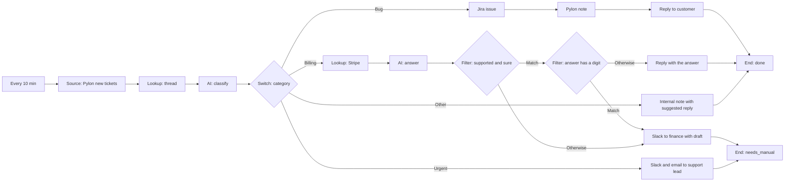

# Story 6. Support ticket to the right place

**Prompt.** "Watch new support tickets in Pylon. Bugs become Jira issues linked back to the ticket. Billing questions get an answer from Stripe data if we're sure, otherwise finance sees it. Urgent ones go to the support lead right away. Everything else gets a suggested reply as an internal note."

**Goal.** Every new support ticket ends up where it belongs, and the customer hears back where the story says so, without a person sorting the queue.

**Input.** Pylon tickets created since the last run. Each becomes an inbox row, so a ticket that was handled is not handled again.

**Output.** By category:

- **Bug:** a Jira issue exists, the ticket has a note naming it, and the customer is told it has been logged.
- **Billing:** when the model says its answer is fully supported by the customer's Stripe data and is sure, and the answer states no amount or date, it is sent on the ticket. Otherwise (including every answer that has a digit in it) finance gets the draft by Slack and the ticket is `needs_manual`.
- **Urgent:** the support lead is told by Slack and email, the ticket is `needs_manual`, and the customer gets no automatic reply.
- **Other:** an internal note with a suggested reply is added to the ticket.

**Runs.** Every 10 minutes.

**Needs.** Pylon and Stripe (vault keys), Jira, Slack and the workspace email sender.

**Waits.** None.

## The path

1. **`tickets` (Source, provider query, remembered in the inbox):** `pylon.newTickets` since the cursor.
2. **`thread` (Lookup, `pylon.ticketThread`):** the ticket's messages. A read that returns nothing at all is a failed lookup.
3. **`classify` (AI, per ticket):** `category` (bug, billing, urgent, other), `severity`, `confidence`, `summary`.
4. **`route` (Switch):**
   - **Bug:** `jira` (Action, `jira.createIssue`, title and description written by the model) then `note` (`pylon.addNote` naming the issue) then `replyCustomer` (`pylon.reply`, a fixed "we have logged this" message) then `done`.
   - **Billing:** `stripe` (Lookup, `stripe.customerBilling`, keyed by the ticket's own requester email) then `answer` (AI: `answer`, `supported`, `confidence`) then `sure` (Filter: supported and confidence high), then `hasFigures` (Filter: the answer text contains any digit). `hasFigures` Otherwise: `sendAnswer` (`pylon.reply` with exactly the answer field) then `done`. Anything that fails `sure`, or matches `hasFigures`: `finance` (Slack to the finance channel with the draft) then `manual`.
   - **Urgent:** `lead` (Slack) and `leadEmail` (email) to the support lead, then `manual`.
   - **Otherwise (other):** `suggest` (`pylon.addNote`, the note written by the model) then `done`.

## What it must never do, and where that is enforced

- **Reply twice to one ticket.** A handled ticket (`resolved`, `dismissed` or `needs_manual`) that the provider offers again is recognised by the Source and not taken (the step records `alreadyHandled`); each reply is also a write under a receipt keyed by the ticket and the node.
- **Use data from any customer other than the ticket's own.** The Stripe lookup is keyed by the ticket's requester email (`item.author`), and the scenarios assert the email of every Stripe request. Stripe is only asked for billing tickets.
- **Reply automatically to an urgent ticket.** The urgent route has no Pylon write at all; the proof asserts no Pylon write for an urgent ticket.
- **Send the customer anything but the validated answer.** `sendAnswer` runs only behind the `sure` and `hasFigures` filters and its body is exactly `nodes.answer.answer`, which the engine has checked is non-empty text.
- **Send an amount or a date to a customer without a person seeing it.** Enforced by the `hasFigures` filter, which reads the answer text and not the model's flags: any digit sends the answer to finance whatever `supported` and `confidence` say (scenario `an-answer-that-states-an-amount-or-a-date-goes-to-finance-whatever-the-model-says`). A real-model check found why the flags cannot be the gate: in nine of nine answers the model said `supported: true, confidence: high`, even when the data did not answer the question, and in four of six answers Stripe's cents were left as a bare figure (`4000 USD` for $40.00). A digit is the deterministic test the rules language allows; an amount or date written in words still passes it.
- **Send a fact that is not in the Stripe data.** Not enforced by code beyond the figures rule. `supported` and `confidence` are set by the model, and nothing compares the answer's facts with the Stripe data. What remains open is a plan name or a claim written without a digit ("We refunded the duplicate charge"): the guarantee is what the model is shown (only this customer's Stripe data), its instruction (use only facts in that data; amounts are cents; when the data does not answer, `supported: false` and `confidence: low`) and its own flags. The scenario `a-model-claiming-support-for-an-invented-fact-is-believed` keeps that gap visible. Closing it needs a check in code, for example that every amount and date in the answer appears in the lookup result, which no node kind does today.
- **Promise a refund or a timeline.** The instructions on `answer` and `suggest` forbid it; the fixed bug reply promises only follow-up.

## Not in this version

- A billing answer that states an amount or a date is never sent on its own: finance answers it. Sending one safely needs a check in code that every amount and date in the answer appears in the Stripe lookup result, which no node kind does today.
- A customer email that is not in Stripe, or matches several customers, is not routed to a person by code: the model is shown whatever Stripe returned and must say `supported: false`. The rules language cannot count a list, so the graph cannot test for "exactly one customer".
- A ticket that fails does not depend on Pylon offering it again, and the Pylon cursor moves on. A failure a later try may fix (the model gave no usable answer) sets the ticket aside at that step, and the third failed attempt hands it to a person; one that cannot be fixed (a thread read that returns nothing) hands it to a person at once (scenario `an-unreadable-ticket-that-is-offered-again-is-handed-to-a-person-on-the-third-try` shows the re-offered case).
- Tickets with attachments are not looked at, and a ticket updated after classification is not re-evaluated.

## Scenarios

- `each-category-lands-where-the-story-says`: five tickets, one per route (billing twice, sure and unsure). The sure answer states no figure, so it is sent.
- `a-model-claiming-support-for-an-invented-fact-is-believed`: the known gap above, an invented refund stated without a figure.
- `an-answer-that-states-an-amount-or-a-date-goes-to-finance-whatever-the-model-says`: the same invented refund with an amount and a date is handed to finance although the model says it is supported and sure.
- `a-ticket-whose-classification-cannot-be-read-fails-alone`: one ticket fails with a typed error, the other is handled, and the failed one is not offered again.
- `an-unreadable-ticket-that-is-offered-again-is-handed-to-a-person-on-the-third-try`: the retry and hand-off when the provider re-offers.
- `a-ticket-offered-again-after-it-was-handled-is-not-handled-twice`: no model call, no second issue or reply.
- `a-thread-that-returns-nothing-is-a-failed-lookup-not-an-empty-ticket`: never classified from nothing.
- `a-test-of-the-classify-node-runs-on-a-sample-ticket-and-sends-nothing`: the test step on a pinned ticket.
- `a-dry-run-sends-nothing`: every read and model answer real, no write.
