# Story 7. Incident to postmortem

**Prompt.** "When a Sentry issue spikes, tell on-call in Slack and by email. Escalate if nobody answers in 15 minutes. When it's resolved, write a postmortem draft in Notion and post the link."

**Goal.** An incident reaches a person quickly, escalates if nobody answers, and ends with a postmortem draft, without anyone assembling it by hand.

**Input.** A new unresolved Sentry issue in the configured project and environment, as the Sentry poller records it in Factory's inbox. There is no spike threshold in this version: every issue the poller offers is treated as an incident.

**Output.** The on-call person is told by Slack message and email. If nobody answers in 15 minutes the escalation contact is told the same way. When the issue resolves, a postmortem page titled `[Draft] ...` exists under the postmortem parent page in Notion, with a timeline whose lines link to Sentry events (no timeline when Sentry recorded none), and its link is posted to the on-call person in Slack. If the issue is still open after 48 hours, the incident owner is told and the item ends `needs_manual`.

**Runs.** Every 5 minutes. A parked incident is looked at every 15 minutes.

**Needs.** Sentry (read issue status and events), Slack, the workspace email sender, Notion.

**Waits.** Two. An answer from anyone (15 minutes), then a condition: the Sentry issue is resolved (re-checked every 15 minutes, up to 48 hours).

## The path

1. **`spikes` (Source, inbox poll, Sentry):** up to 5 new issues a run.
2. **`summarize` (AI, per item):** `severity`, `summary`, `suspectedArea`.
3. **`pageSlack` and `pageEmail` (Actions):** the summary to the on-call person by Slack and by email.
4. **`ack` (Wait, reply, 15 minutes, anyone):** watches the thread of the Slack page. An answer goes on to `resolved`. Silence goes to `escalate` and `escalateEmail` (the escalation contact, Slack and email), then on to `resolved`.
5. **`resolved` (Wait, condition):** reads `sentry.issueStatus` every 15 minutes until the status is `resolved` (Met), up to 48 hours. At the limit (Timed out): `owner` tells the incident owner and `manual` ends the item `needs_manual`.
6. On Met: **`gather`** (Lookup, `sentry.issueEvents`) reads the issue's recent events; **`postmortem`** (AI) writes `title`, `summary`, `timeline` (a list of `{at, what, eventId, link}`, one per recorded event, with `at`, `eventId` and `link` copied from that event; empty when there are none), `impact`, `causes`, `followUps` and the whole page as `body`; **`notion`** creates the draft page from `body`; **`announce`** posts the page's link; **`done`** ends the item.

```mermaid
flowchart LR
  t[Every 5 min] --> spikes[Source: Sentry spikes] --> summarize[AI: severity and summary] --> pageSlack[Slack to on-call] --> pageEmail[Email to on-call] --> ack[Wait: answer, 15 min]
  ack -->|Replied| resolved[Wait: issue resolved, 48h]
  ack -->|Timed out| escalate[Slack to escalation contact] --> escalateEmail[Email to escalation contact] --> resolved
  resolved -->|Met| gather[Lookup: events] --> postmortem[AI: write postmortem] --> notion[Action: Notion draft] --> announce[Slack: link] --> done[End: done]
  resolved -->|Timed out| owner[Slack to incident owner] --> manual[End: needs_manual]
```

## What it must never do, and where that is enforced

- **Mark an incident resolved itself.** The catalog has no Sentry write operation, so no node can; a spec checks every Sentry call in every scenario is a read. The item's own status becomes `resolved` only at `done`, after Sentry says the issue is.
- **Put anything in the postmortem that no recorded event backs.** Partly enforced. The model is given the issue's recorded events with their ids and links (`gather`) and is instructed to cite one per timeline entry, copying the id and link from the event, never to cite the issue itself as an event, to leave the timeline empty when there are no events, and to state nothing unsupported. No node can check that, because the result is prose; the spec checks what the model is shown, that the page carries every link, that the scripted answers cite only shown events, and that a run with no events produces an empty timeline. A validator for cited ids is not built (see the todo in the proofs). A real-model check found the cause of the instruction: with events the model cited real ones in three runs of three, and with none it cited the issue's id as if it were an event in three of three.
- **Notify the same level twice.** Each message is a write under a receipt keyed by the issue and the node, and an issue that waits is not taken again however often the source offers it.
- **Publish outside the Drafts area.** The page's title starts `[Draft]` and its parent is the postmortem parent page setting.
- **Read a failed status check as "not resolved" or as the end of the wait.** A read that fails for a reason a later look may fix (Sentry unavailable) leaves the item waiting with its deadline and spends no attempt; it reads again at its next check, and only a successful read at or past the deadline times it out. A read that cannot succeed hands the item to a person at once, and so does one that has failed on every look for two hours.

## Not in this version

- A spike threshold. The poller offers every new unresolved issue; "spikes" in the prompt is not yet a condition anything checks.
- The postmortem is built from the issue's events only. The incident's Slack thread and recently merged pull requests are not read.
- The link is posted to the on-call person as a new message, not into the thread of the page.
- If Notion is down the postmortem text is not posted anywhere instead: the write is set aside for a retry after 5 and then 10 minutes, and the third failure sends the incident to a person (`needs_manual`), with nothing announced.
- Paging depends on the model: if `summarize` cannot return its fields, nothing is sent and the incident goes to a person after three tries. A page that does not wait for the model would need the page text to stop reading the summary.
- No on-call person configured: the page fails at its first step because the setting has no value.

## Scenarios

- `an-answered-incident-resolves-into-a-postmortem-draft`: the whole path, with the condition re-checked on its cadence and the model shown the events.
- `nobody-answers-so-the-escalation-contact-is-told-and-the-issue-still-resolves`: escalation at 15 minutes; resolution without an answer.
- `an-issue-with-no-recorded-events-gets-a-postmortem-with-an-empty-timeline`: Sentry has no events at resolution: the model is shown an empty list, the timeline is empty, the page carries no event link, and the draft is still created and announced.
- `still-open-after-48-hours-tells-the-incident-owner`: the 48-hour limit.
- `a-failed-status-read-is-neither-resolved-nor-a-timeout`: a failing read, including one at the deadline, keeps the item waiting without spending an attempt.
- `the-model-cannot-summarize-so-nobody-is-paged-and-a-person-is-handed-the-incident`: what a model failure does today.
- `notion-down-leaves-the-incident-for-a-person`: three failed writes, nothing announced.
- `the-same-issue-offered-again-is-paged-once`: repeat offers while it waits.
