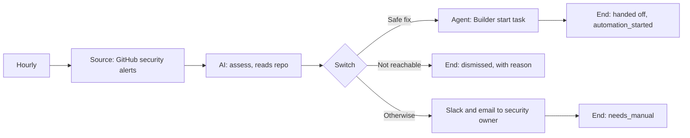

# Story 8. Security alert to safe fix

**Prompt.** "For new security alerts, check whether the vulnerable code is actually used. Safe upgrades go to Builder. Critical or unclear ones go to the security owner. Unused ones are dismissed."

**Goal.** Security alerts are judged for whether they matter in this repository. Safe upgrades go to Builder as a pull request, and a person gets everything else.

**Input.** The repository's open Dependabot (dependency) security alerts. GitHub lists every open alert on every run, so the Source skips the ones already handled.

**Output.** One of:

- Builder has a task for a safe upgrade and the alert is `automation_started` (the merge is followed by story 2);
- the security owner is told by Slack and email and the alert is `needs_manual` (critical, unclear, a major upgrade or code change, or a fix that touches a sensitive area);
- the alert is `dismissed` with the model's reason, when the model is confident the vulnerable code is not reachable and the severity is low or medium.

**Runs.** Hourly.

**Needs.** GitHub (a token that can read security alerts), Slack, the workspace email sender and Builder.

**Waits.** None.

## The path

1. **`alerts` (Source, provider query, remembered in the inbox):** `github.listSecurityAlerts` for the repository setting. A token without the scope fails the run with `credential_missing`; it never reads as an hour with no alerts.
2. **`assess` (AI, per alert, read-only tools `github.readFile` and `github.searchCode`):** `severity`, `reachable`, `fixKind` (patch, minor, major, code change), `confidence`, and the Builder gate fields `clearBug`, `risk`, `productUxImplications`, `categories`, plus a `reason`.
3. **`route` (Switch), first match wins:**
   - **Safe fix:** a patch or minor upgrade, severity not critical, confidence high, a clear bug, low risk, no product or design question, and no sensitive category. Goes to `builder`.
   - **Not reachable:** reachable is false, severity is low or medium, and confidence is high. Goes to `dismissed` with the model's reason.
   - **Otherwise:** to the security owner.
4. **`builder` (Agent, `builder.start`):** project from the `builderProjectId` setting (the one story 2 follows), branch `factory-alert-<alert number>`, a model-written prompt, and the gate fields bound from the assessment (`alreadyClaimed` is fixed false: a dependency alert is not a chat message). Then `handed` (End, done, status `automation_started`).
5. **`notify` (Slack) and `notifyEmail` (email)** to the security owner, then `manual` (End, needs_manual).

## What it must never do, and where that is enforced

- **Dismiss a high or critical alert.** The `unreachable` route requires severity `low` or `medium` (node settings), and the proof asserts across every scenario that no high or critical alert ends dismissed. An alert the model cannot decide never dismisses either: a failed AI turn fails the alert and writes no status.
- **Dismiss an unclear alert.** The `unreachable` route also requires confidence `high`, so "probably unused" goes to a person. (The first draft dismissed on `reachable: false` alone.)
- **Change anything in the repository.** The graph's only writes are `builder.start`, Slack and email, and the model's tools are exactly the two read-only repository operations; both are catalog reads, which the proof asserts. Builder does the change through a pull request that story 2 gates.
- **Give the model write tools or code execution.** `assess` can only name catalog read operations as tools; the graph validator refuses a write.
- **Start Builder for something the dispatch gate refuses.** The gate (clear bug, low risk, high confidence, no product question, not claimed, no never-automate category, no duplicate) runs inside `builder.start`, before Builder is called; the route mirrors it, so what the model rates unsafe never reaches it. When the gate refuses anyway (a duplicate), the alert fails at `builder` and goes to a person at once: the same start would be refused again. Asserted in the host's `builder-start-gate` and `builder-operations` specs; the scenarios here assert the engine's side.
- **Start Builder twice for one alert.** The start is a write under a receipt keyed by the alert. A start that timed out may have gone through, so the alert is held for a person and never sent again; a start that was refused had no effect, would be refused again, and goes to a person without a retry.

## Not in this version

- A safe fix does not yet reach story 2. Story 2 reads the Builder task from `item.extras.builderTaskId`, `projectId`, `branchName` and `repository` on the inbox row, and nothing records them when `handed` sets `automation_started`. The End needs to record the Builder task on the row. See the todo in `proofs.spec.ts`.
- An alert handed to Builder is listed by GitHub again until its fix merges, and `automation_started` does not count as handled, so it is assessed again every hour (a model call each time; its Builder start is found already done). A model that then changed its mind could move it to `needs_manual`.
- Code scanning alerts: only Dependabot alerts are read.
- A refusal by the gate is not announced: the alert goes to a person without a message.

## Scenarios

- `each-alert-lands-where-the-story-says`: six alerts, each route: a safe patch to Builder, a critical alert, a high-severity alert the model thinks unreachable, an unreachable one it is unsure of and a major upgrade to the security owner, and one confidently unreachable low-severity alert dismissed.
- `a-fix-that-touches-a-sensitive-area-goes-to-a-person`: a patch the model rates safe that touches auth never reaches Builder.
- `an-ai-turn-that-fails-never-dismisses-the-alert`: the alert fails, nothing is written.
- `a-refused-start-hands-the-alert-to-a-person-at-once`: one refusal, `needs_manual`, no retry on the hours after.
- `a-start-that-timed-out-is-never-sent-twice`: needs a check, held for a person, not started again when the alert is listed again.
- `an-alert-handed-to-builder-is-listed-again-and-builder-is-not-started-twice`: the known re-assessment above, with no second start.
- `a-token-that-cannot-read-alerts-fails-the-run-loudly`: a failed run, no AI, no status.
- `a-dry-run-hands-nothing-to-builder-and-tells-no-one`: the full routing, no writes.
