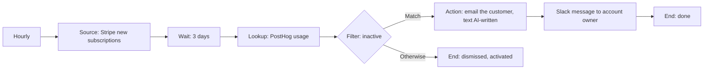

# Story 9. New-customer activation nudge

**Prompt.** "Three days after a new customer subscribes, check whether they've used the product. If not, email them a friendly nudge and tell the account owner."

**Goal.** A new paying customer who has not started using the product after three days gets a nudge, and the account owner knows.

**Input.** A new active Stripe subscription.

**Output.** Three days after the subscription was taken, if usage is below the threshold: one email goes to the customer and the account owner gets one Slack message saying it was sent. If the customer is active, nothing is sent and the item ends `dismissed` with the reason "activated". If usage cannot be read, nothing is sent: a read that may pass (PostHog unavailable) is tried again on the ticks after, and after three tries a person is handed the customer; a count that cannot be read at all hands the customer to a person at once.

**Runs.** Hourly. A customer who is waiting is looked at again on every tick, and is acted on at the first tick at or after the three days.

**Needs.** Stripe and PostHog (vault keys), the workspace email sender, Slack.

**Waits.** One: a fixed three days (a time Wait). The customer is parked at the Wait, not the run.

## The path

1. **`subs` (Source, provider query):** Stripe subscriptions since the saved cursor, one inbox row per subscription (deduped by subscription id). A subscription already handled (`resolved`, `dismissed` or `needs_manual`) is not taken again; one that is still waiting is held by its parked row and is not taken again either. The cursor is saved only when the whole run completes. The host's first live run of a cursor source only primes the cursor and takes nothing, so enabling the workflow does not nudge the whole backlog.
2. **`pause` (Wait, time):** parks the customer for exactly 3 days. Nothing wakes it earlier.
3. **`usage` (Lookup, `posthog.usage`):** counts the customer's key events over the last 3 days.
4. **`inactive` (Filter):** fewer than `minKeyEvents` (3, a workflow setting) events. Match goes to the nudge; Otherwise ends `dismissed` as "activated". A count the filter cannot read (no `results`, an empty list, text where a number belongs) fails the customer instead of matching.
5. **`mail` (Action, `email.send`):** emails the customer. The body is written by the model: a greeting, the one first thing to try, a docs link, and no pricing, discounts or plan.
6. **`tellOwner` (Action, `slack.postMessage`):** tells the account owner the nudge was sent.
7. **`done` (End, done)** and **`activated` (End, dismissed, "activated")**.

## What it must never do, and where that is enforced

- **Email an active customer.** The Filter reads the count after the Wait; only Match reaches `mail`. Asserted from the scenarios: zero `email.send` calls when usage is 12.
- **Send more than one nudge per subscription.** Three layers, all asserted: the row of a waiting customer is held by its parked row; a subscription that ended is reported `terminal` by the inbox and not taken again (the step records `alreadyHandled`); and the email is under a receipt keyed by the item, so a tick that died after sending finds the receipt open and hands the customer to a person instead of sending again.
- **Treat a failed usage lookup as "inactive".** A failed lookup fails the item (one that may pass spends an attempt and is retried; the third failure hands it to a person), and a count the Filter cannot read fails it too and hands it to a person at once. Both are asserted, with no email in either.
- **Mention pricing or discounts.** Enforced by the model's instruction only; the scenario asserts the model is given it. No code can check prose.
- **Email someone who opted out.** Not enforced: see below.

## Not in this version

- A customer who cancelled or was refunded during the three days is still nudged: nothing re-reads the subscription after the Wait.
- An opt-out list: no node reads one.
- A customer PostHog does not know reads as zero events and is nudged, because PostHog answers a count of 0 for an unknown person; there is no "cannot find the customer" branch.

## Scenarios

- `an-inactive-customer-is-nudged-exactly-three-days-later`: the primed cursor, the subscription, no action an hour before the deadline, the nudge at three days, the cursor handed back on every read.
- `the-wait-is-exactly-three-days`: a minute before the deadline the customer is parked, due at exactly three days.
- `an-active-customer-gets-nothing`: dismissed as activated; offered again afterwards, not taken.
- `one-nudge-per-subscription`: offered again while waiting and after the nudge; one email, one Slack message.
- `a-tick-that-dies-after-the-email-never-sends-a-second-one`: the open receipt stops a repeat and hands the customer to a person.
- `a-failed-usage-lookup-is-never-read-as-inactive`: PostHog unavailable; retried; a person after the third failure.
- `an-answer-with-no-count-fails-the-item-instead-of-matching`: no usable count; fails at the Filter, never matches, a person at once.
- `testing-the-filter-on-pinned-samples`: the Filter run alone on two pinned customers, as the canvas's test step does.
