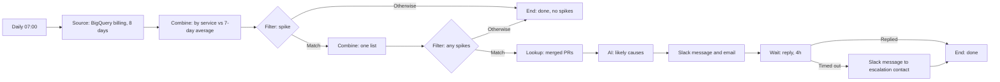

# Story 10. Cloud-cost spike

**Prompt.** "Each morning check cloud spend by service against the last seven days. If something spiked, tell the owners with the likely cause (recent merged PRs or deploys), and escalate if nobody replies in four hours."

**Goal.** A jump in cloud spend reaches the owners the same morning with likely causes, and escalates if nobody responds.

**Input.** Eight days of daily billing rows from the BigQuery billing export, one row per service and day.

**Output.** On a spike day: one Slack message to the owners' channel and one email to the manager, together naming every spiking service with its numbers and the merged pull requests that likely caused it, each with its link; then an escalation Slack message to the escalation contact if nobody answers within four hours. On a quiet day: a recorded run that ended with "no spikes", and no message.

**Runs.** Daily at 07:00 in the workflow's timezone (America/Los_Angeles in the shipped graph). A spike that is waiting is looked at again every 15 minutes (the workflow's check cadence).

**Needs.** BigQuery, GitHub (merged pull requests), Slack, the workspace email sender.

**Waits.** One: a reply from anyone but a bot, up to four hours. The parked item is the combined spike list, not an inbox row, so its row carries the bounded spike context.

## The path

1. **`billing` (Source, window):** the 8-day billing query. Each row becomes an item for one service and one day.
2. **`byService` (Combine, summarize):** one item per service: yesterday's cost (the latest day) against the average of the days before it (up to seven), as an amount and a percent increase. A service with no earlier day, or an average of zero, has nothing to compare with and is left out; the step records which (`skippedGroups`).
3. **`spike` (Filter):** more than 40% and more than $50 a day over the average (the settings `spikePercent` and `spikeDollars`). Both floors must be crossed. Match goes on; Otherwise ends as `done`, "no spikes", for that service.
4. **`spikes` (Combine, list):** every spiking service folded into one item, carrying each service's numbers. With none it is still one item with a count of 0.
5. **`anySpikes` (Filter):** holds back the empty list of a quiet day: nothing is sent for it, and it ends as `done` with "no spikes", which is the record of why.
6. **`recent` (Lookup, `github.mergedPullRequests`):** pull requests merged since the start of this run's window (the last day), attached to the spike item.
7. **`explain` (AI):** one message about all the spiking services: for each its cost against the average, the percent, and the likely causes from the merged list with their links. It is told to name no cause it has no link for.
8. **`notifyOwners` (Slack message to the owners' channel) and `emailOwners` (email to the manager)**, both with the model's message.
9. **`waitReply` (Wait, reply, 4 hours):** watches the thread the Slack message opened. A reply ends the spike as `done`. Four hours without one goes out by `timedOut`: **`escalate`** posts one Slack message to the escalation contact, then `done`.

## What it must never do, and where that is enforced

- **Alert on a swing under a floor.** The Filter needs both floors. The scenarios carry a service that rose 100% by $2 (under the dollar floor) and one that rose $60 by 20% (under the percent floor); neither is alerted. The comparison is strictly more than, not "at least".
- **Alert twice in a day.** The 07:00 tick is keyed by its instant, so a redelivered tick does nothing; one message covers every spiking service, so two services never mean two alerts. A manual run the same day would alert again: see below.
- **Name a suspect without a link.** Enforced by the model's instruction only. What the code does guarantee, and the scenario asserts, is that the model is shown the pull requests with their links and that every link in its answer is one of them.
- **Take any action on cloud resources.** The graph names only `slack.postMessage` and `email.send` as writes, and the catalog has no cloud write operation to name; the proof reads the graph's write operations.
- **Treat a failed lookup or step as a quiet day.** Only partly: see "Known gaps".

## Known gaps

- **BigQuery costs arrive as text.** The host maps a BigQuery cell as it is, so `extras.cost` is `"100"`, and the Summarize step refuses text, so on a real response every row fails (`byService` failed, 16 item failures in the scenario). The scenarios that show a working spike use numeric costs; `billing-costs-delivered-as-text-fail-instead-of-summing` shows the behavior as it is today.
- **A failed Summarize reads as a quiet day.** When every row fails, the empty list still reaches `spikes` and the run ends `done` with "no spikes", beside a failed step. The step is flagged and the run counts the failures, but the recorded reason is wrong.
- **Missing data is compared as if it were yesterday.** If yesterday's rows are absent, the latest day present is used and the run records "no spikes" (the step output says `latestBucket` is two days old). There is no "billing data is late" message.

## Not in this version

- Waiting for late billing data until 10:00 and then telling the owner it is late.
- Owners per service: one owners' channel and one manager email stand for them (the plan's service-to-owner setting is not read).
- Stopping a manual run on a day that already alerted.
- A deploy lookup: only merged pull requests are read.

## Scenarios

- `a-spike-day-alerts-the-owners-with-suspects-and-a-reply-ends-it`: two spiking services among five, one alert with links, parked, a reply ends it.
- `silence-for-four-hours-escalates-once-and-a-bot-does-not-count`: one escalation at four hours.
- `the-spike-waits-exactly-four-hours`: the parked row's deadline and check time.
- `a-quiet-day-sends-nothing-and-records-why`: nothing sent, nothing looked up, the reason recorded.
- `the-same-tick-delivered-twice-alerts-once`: a redelivered tick sends nothing.
- `billing-costs-delivered-as-text-fail-instead-of-summing`: the gap above, as it stands.
